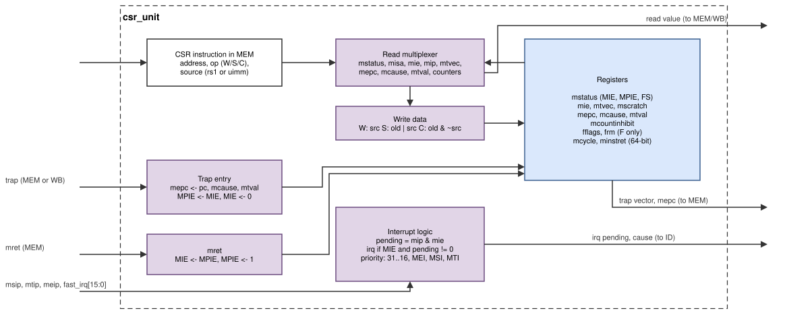
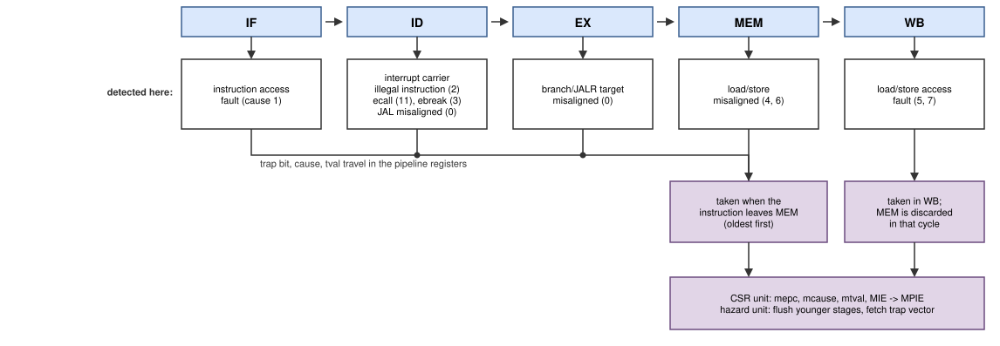

# CSRs, traps and interrupts

The CSR unit (`rtl/core/csr_unit.v`) holds the machine-mode control and
status registers, takes traps, returns from them with `mret`, counts cycles
and retired instructions, and decides which interrupt is taken, as the
privileged specification [[RV-PRIV]](references.md#risc-v-specifications) defines for machine mode. The CSR
list, the trap causes and what software sees are in
[Programmer's model](programming.md); this chapter explains how the unit
does it.



*Figure: the CSR unit. CSR instructions, traps and `mret` act when the
instruction leaves MEM.*

## CSR instructions

CSRRW, CSRRS, CSRRC and their immediate forms read the old value and write
a new one in one step:

| Operation | New value |
|---|---|
| write (CSRRW[I]) | `src` |
| set (CSRRS[I]) | `old \| src` |
| clear (CSRRC[I]) | `old & ~src` |

`src` is rs1 or the 5-bit immediate. The access happens when the
instruction commits in MEM: the old value goes into MEM/WB as the result,
and the new value is written in the same cycle. The read value is therefore
a *late* result: an instruction that uses it right away waits one cycle.

The floating-point flags of each FP instruction travel with it down the
pipeline and are OR-ed into `fflags` when it commits (sticky flags), so a
CSR read of `fflags` sees exactly the older instructions.

## Traps

A *trap* is an exception (caused by an instruction) or an interrupt.



*Figure: each exception is detected in the stage that has the information,
travels with its instruction, and is taken in order when the instruction
leaves MEM; access faults, which are only known in WB, are taken there.*

| Cause | Exception | Detected in |
|---|---|---|
| 0 | instruction address misaligned | ID (JAL), EX (branch, JALR) |
| 1 | instruction access fault | IF (error response) |
| 2 | illegal instruction | ID |
| 3 | breakpoint (EBREAK) | ID |
| 4, 6 | load, store address misaligned | MEM |
| 5, 7 | load, store access fault | WB (error response) |
| 11 | environment call from M-mode (ECALL) | ID |

The stage that detects an exception only marks the instruction (a `trap`
bit, the cause and `tval`) and clears its side effects. The trap is taken
when the instruction reaches MEM, so every older instruction has completed
by then. Taking it is one cycle in the CSR unit: `mepc`, `mcause`, `mtval`
and `mstatus` are written as listed in
[Programmer's model: traps](programming.md#traps), and the hazard unit
flushes IF/ID, ID/EX and EX/MEM and redirects the fetch to the trap vector.
Access faults are known only when the response arrives in WB; they are
taken there, and the younger instruction in MEM is discarded in the same
cycle.

## Interrupts

```text
pending = mip & mie
take an interrupt when mstatus.MIE = 1 and pending != 0
cause   = highest pending fast line (31..16),
          else MEI (11), else MSI (3), else MTI (7)
```

The pending interrupt is attached to the instruction in ID, which becomes
an *interrupt carrier* ([Decode](core-decode.md#trap-selection-and-interrupt-carriers)).
The carrier traps in MEM like any exception, so all older instructions
complete and `mepc` points to the first instruction that did not execute.
A write to `mstatus` or `mie` refetches the next instruction, so a newly
enabled interrupt is taken right after the enabling instruction.

## Design decisions

The CSR and trap design follows a written study of the options for a
small five-stage core:

| Question | Decision | Reason |
|---|---|---|
| privilege modes | machine mode only | no operating system; smallest correct design |
| commit point | when the instruction leaves MEM | the oldest instruction that can still trap; precise traps |
| interrupt entry | tag the instruction in ID | interrupts enter in program order; no extra flush logic |
| `mtvec` modes | direct and vectored | the HORNET drivers use vectored mode for fast dispatch |
| `mtval` | as Spike | the co-simulation compares it |
| `time` | from the SoC timer | standard CLINT behaviour, needed by the C library |
| debug triggers | read as zero | needed by `rv32mi` tests and Spike's defaults |
| WFI | no-op | allowed by the specification; no clock gating on the FPGA |
| fast interrupts | 16 lines in `mip/mie[31:16]` | version 1 had them; the UART and GPIO use two |
| F state | `fflags`, `frm`, `fcsr`, `mstatus.FS/SD` | required by the F extension; illegal F instructions while FS = Off |
| refetch | after FENCE.I and writes to `mstatus`, `mie`, `frm`, `fcsr` | younger instructions were decoded with the old state |
| `mepc` reset | bits 1:0 always read 0 | found by riscv-formal: an `mret` before the first write could jump to a misaligned PC |
