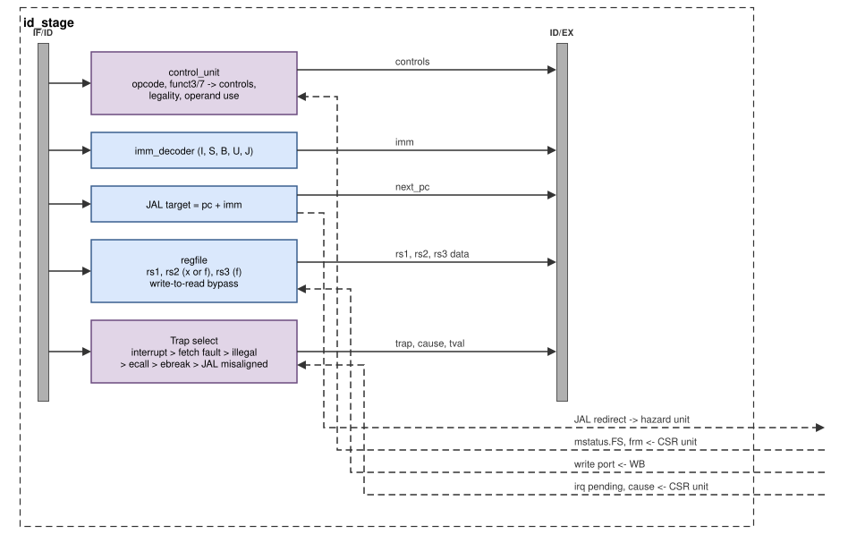

# Instruction decode (ID)

The decode stage (`rtl/core/id_stage.v`) turns the 32-bit instruction into
control signals, reads up to three source registers, resolves JAL, decides
whether the instruction traps, and turns an instruction into an *interrupt
carrier* when an interrupt is pending. Its result goes into the ID/EX
register.

*Figure: the decode stage. Dashed lines connect to other blocks: the CSR
unit supplies the floating-point state and pending interrupts, WB writes
the register files, and JAL redirects go to the hazard unit.*

## Blocks

### Control unit (`control_unit.v`)

A combinational decoder, one `case` on the opcode with sub-cases on
`funct3`, `funct7` and the register fields. For every instruction it
produces:

| Output | Meaning |
|---|---|
| `rs1_used`, `rs2_used`, `rs3_used`, `rs1_fp`, `rs2_fp` | which source registers are read, and whether they are float registers (hazard detection uses these) |
| `rd_we`, `rd_fp` | the instruction writes a destination register, integer or float |
| `alu_func`, `alu_a_pc`, `alu_b_imm` | ALU operation; operand A is the PC (AUIPC), operand B the immediate |
| `res_sel` | which EX result is kept: ALU, PC + 4 (JAL/JALR), divider, FPU |
| `branch`, `jal`, `jalr`, `load`, `store`, `mem_size`, `mem_unsigned` | control flow and memory access |
| `mul`, `div`, `fpu`, `fpu_op`, `fpu_rm` | M and F operations; `fpu_rm` is the static rounding mode, or `frm` for dynamic rounding |
| `csr`, `csr_we`, `csr_imm` | CSR instruction; it writes (CSRRW, or CSRRS/C with rs1 ≠ x0); the source is the 5-bit immediate |
| `ecall`, `ebreak`, `mret`, `fence_i` | system instructions |
| `illegal` | the encoding is not a legal instruction of this configuration |

**Legality is exact.** An encoding is legal only if it is a defined
instruction of RV32I/M/F with Zicsr and Zifencei *in this configuration*:

| Group | Rule |
|---|---|
| shifts, OP, OP-IMM | `funct7` must be `0000000` or `0100000` (SUB, SRA, SRAI) as defined |
| loads, stores, branches, JALR | reserved `funct3` values are illegal |
| M instructions | legal only with `RV_M = 1` |
| F instructions and F CSRs | legal only with `RV_F = 1` and `mstatus.FS` ≠ Off |
| F rounding mode | `rm` = 5 or 6 is illegal; `rm` = 7 (dynamic) is illegal while `frm` holds 5, 6 or 7 |
| F register fields | fixed fields (`rs2` of FSQRT, FCVT, FMV, FCLASS; `fmt` of the fused forms) must be as defined |
| CSRs | the address must exist; writing a read-only CSR (address bits 11:10 = `11`) is illegal |
| SYSTEM | only ECALL, EBREAK, MRET and WFI (a no-op) |
| MISC-MEM | FENCE (a no-op) and FENCE.I |

An illegal instruction has all its side-effect controls cleared, so it
travels down the pipeline only to raise its exception.

### Immediate decoder (`imm_decoder.v`)

Builds the sign-extended I, S, B, U or J immediate from the instruction
bits (kept from version 1).

### Register files (`regfile.v`)

| | Integer | Float (F only) |
|---|---|---|
| Registers | `x1`–`x31` (`x0` reads as 0) | `f0`–`f31` |
| Read ports | rs1, rs2 | rs1, rs2, rs3 (fused multiply-add) |
| Write port | shared: one write per cycle, from WB | |

Each read port selects the integer or the float bank with the `rs*_fp`
bit from the decoder. A write and a read of the same register in the same
cycle return the new value (write-to-read bypass). Without F the float bank
does not exist and float reads return 0.

### JAL target

`pc + imm` is computed in ID. If the instruction is a JAL and the target is
aligned, ID asks the hazard unit to redirect; the next PC stored in ID/EX
is the target. A misaligned target (bit 1 set) does not redirect; the JAL
raises an instruction-address-misaligned exception instead.

### Trap selection and interrupt carriers

Every instruction leaves ID with a `trap` bit, a cause and a `tval`. The
first matching row decides:

| Priority | Condition | Cause | `mtval` |
|---|---|---|---|
| 1 | interrupt pending (from the CSR unit) | interrupt cause, `mcause[31] = 1` | 0 |
| 2 | fetch error | 1, instruction access fault | PC |
| 3 | illegal instruction | 2 | the instruction word |
| 4 | ECALL | 11, environment call from M-mode | 0 |
| 5 | EBREAK | 3, breakpoint | PC |
| 6 | JAL with a misaligned target | 0, instruction address misaligned | target |

**Interrupt carriers.** When the CSR unit reports a pending, enabled
interrupt, the instruction in ID is turned into a carrier: it is not
executed (all its controls are cleared), it does not retire, and it traps
when it reaches MEM with `mepc` = its own PC. After `mret`, execution resumes
with that instruction. This way an interrupt enters the pipeline in program
order, like any exception, and needs no special flush logic.

## Design decisions

**Exact decoding.** Version 1 accepted many reserved encodings, never
flagged F instructions as illegal and decoded FENCE as illegal (which made
standard startup code trap). Version 2 decodes exactly; the riscv-formal
`ill` check and random illegal words in the verification programs confirm
it against Spike.

**Interrupts tagged in ID.** Taking an interrupt by flushing "whatever is
not a bubble" (version 1) depends on what happens to be in the pipeline
and broke under some stall patterns. Tagging one instruction makes the
interrupt precise by construction: everything older completes, everything
younger is flushed by the normal trap mechanism.

**FPU state checked in ID.** `mstatus.FS` and `frm` decide legality, so the
decoder needs them. Writes to `mstatus` and `frm`/`fcsr` therefore cause a
refetch of the next instruction (see [CSRs and traps](core-csr-traps.md)),
so that no instruction decoded with the old value can execute.
