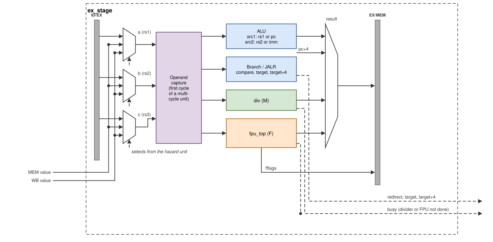
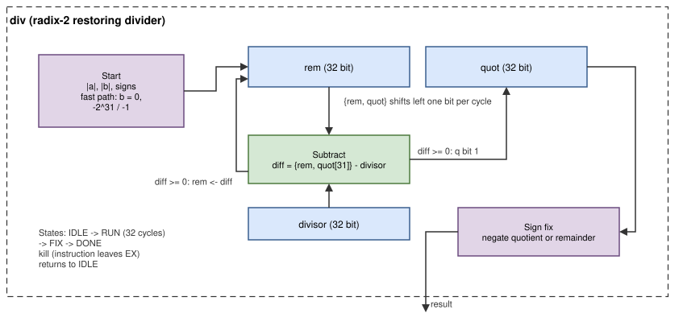

# Execute (EX)

The execute stage (`rtl/core/ex_stage.v`) selects the newest value of each
operand, computes the result in the ALU, the divider or the FPU, resolves
branches and JALR, and writes everything the later stages need into
EX/MEM. Two of its units take many cycles; EX tells the hazard unit with
`busy` and keeps the instruction until the result is ready.



*Figure: the execute stage. The forwarding multiplexers choose between the
register value from ID/EX, the value of the instruction in MEM and the
write-back value; the selects come from the hazard unit.*

## Operand selection

Three forwarding multiplexers (a = rs1, b = rs2, c = rs3) choose between
ID/EX, MEM and WB as described in [The pipeline: forwarding](pipeline.md#forwarding).
An operand the instruction does not use is forced to 0, so that the RVFI
report shows clean values.

**Operand capture.** A multi-cycle unit (divider, FMA, divide/square
root, conversion) captures its operands in its first EX cycle, when the
forwarding is still valid. In the following cycles the producers move on
(they leave MEM and WB), so the forwarding multiplexers would no longer
deliver the right value; the unit uses the captured copy instead. The
capture is only done in a cycle without a memory wait, because during a
wait the forwarded values may not be final.

## ALU (`ALU.v`)

| `alu_func` | Operation | Used by |
|---|---|---|
| ADD, SUB | `a + b`, `a − b` | ADD[I], SUB, AUIPC, address calculation |
| XOR, OR, AND | bitwise | XOR[I], OR[I], AND[I] |
| SLT, SLTU | signed / unsigned `a < b` → 1 or 0 | SLT[I][U], BLT, BLTU |
| SLL, SRL, SRA | shifts by `b[4:0]` | shifts |
| EQ, NE, GE, GEU | comparison → 1 or 0 | BEQ, BNE, BGE, BGEU |
| PASS | `b` | LUI |

Operand A is rs1 or the PC (AUIPC); operand B is rs2 or the immediate.
Loads and stores use the ALU to compute `rs1 + imm`.

## Branches and JALR

- A branch is taken when the ALU comparison returns 1. JALR is always
  taken.
- Target: `pc + imm` for branches, `(rs1 + imm) & ~1` for JALR.
- `target + 4` is computed in parallel (`rs1 + (imm + 4)` for JALR) for
  the fetch unit.
- A taken branch or JALR whose target is not 4-byte aligned does not
  redirect; it raises an instruction-address-misaligned exception (cause 0,
  `mtval` = target) and does not write its link register.
- Otherwise EX requests a redirect from the hazard unit, which flushes the
  two younger instructions in IF/ID and ID/EX.

JAL is not handled here; it was resolved in ID.

## Divider (`div.v`, M extension)

DIV, DIVU, REM and REMU use one radix-2 *restoring* divider [[PARHAMI]](references.md#arithmetic)
that produces one quotient bit per cycle.



*Figure: the restoring divider. The remainder and quotient form one
64-bit shift register; each cycle one trial subtraction decides one
quotient bit.*

**Algorithm.** Signed operands are first made positive; the signs are
remembered.

```text
rem = 0; quot = |a|
repeat 32 times:
    # bring down the next bit of the dividend
    {rem, quot} = {rem, quot} << 1
    if rem >= |b|:  rem = rem - |b|; quot[0] = 1
    else:           quot[0] = 0     # "restore": keep the old remainder
quotient  = sign(a) xor sign(b) ? -quot : quot
# the remainder has the sign of the dividend
remainder = sign(a) ? -rem : rem
```

Example, 13 / 4 in 4 bits: the dividend bits 1, 1, 0, 1 are brought down one
by one; the partial remainders are 1, 3, 6 → 2 (bit 1), 5 → 1 (bit 1), giving
quotient `0011` = 3 and remainder 1.

**Special cases** (the RISC-V results, no exception), answered without
iterating:

| Case | DIV / DIVU | REM / REMU |
|---|---|---|
| division by zero | −1 (all ones) | the dividend |
| `−2^31 / −1` (signed overflow) | `−2^31` | 0 |

**Timing.** States IDLE → RUN (32 cycles) → FIX (sign correction) → DONE.
The instruction stays 35 cycles in EX (2 for the special cases). While the
divider works, the instructions in MEM and WB complete normally; the
younger ones wait in IF/ID and ID/EX, and EX/MEM receives bubbles. When the
instruction leaves EX in any way (it completes, or a trap flushes it) the
divider returns to IDLE.

## FPU

With `RV_F = 1`, `fpu_top` sits in EX next to the divider. Single-cycle
operations (sign injection, min/max, compare, classify, moves) finish in
the first EX cycle; FMA operations take 6 cycles, FDIV 30, FSQRT 29 and
conversions 3. The [FPU chapter](fpu.md) describes it. The exception flags
an FP instruction raises go into EX/MEM next to its result and are
accumulated into `fflags` when it commits.

## Result selection

| `res_sel` / instruction | Value written into `EX/MEM.result` |
|---|---|
| ALU | ALU output (also the load/store address) |
| PC+4 | link address of JAL and JALR |
| DIV | divider result (multiplies use this slot too; MEM replaces it with the product) |
| FPU | FPU result |
| CSR instruction | the CSR source operand: rs1, or the 5-bit immediate |

EX/MEM also receives the store data (rs2 value), the register addresses,
the memory controls, the trap information and the next PC (target or
pc + 4), which RVFI reports.

## Design decisions

**Long-latency units in EX, with operand capture.** Putting the divider
and the FPU in EX keeps every instruction's result in one place for
forwarding and lets older instructions drain while the unit works. Version
1 instead stalled the whole pipeline for every multiply and divide. Capturing
the operands in the first cycle means the forwarding network does not have
to keep producers in place for 30 cycles.

**A simple radix-2 divider.** Division is rare in the target programs; a
radix-2 restoring divider is small (one 33-bit subtractor), easy to
understand and to verify. Higher-radix or SRT dividers would save cycles at
a large cost in area and verification effort.

**The multiplier is not in EX.** See
[Memory and write-back](core-memory-writeback.md#design-decisions).
