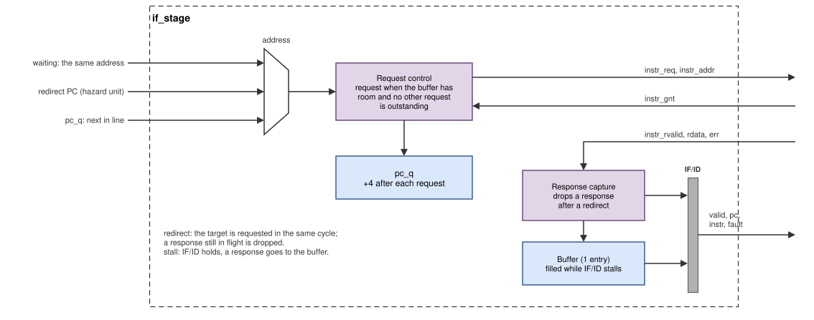

# Instruction fetch (IF)

The fetch unit (`rtl/core/if_stage.v`) keeps the instruction stream
flowing: it sends one request per cycle to the instruction port, puts the
answers into the IF/ID register, and changes direction immediately when the
hazard unit redirects it. It works with memories that answer in one cycle
(the SoC's block RAM) and with memories that take any number of wait states
(the verification runs).

*Figure: the fetch unit. The address multiplexer chooses between the
address of a request that is still waiting for its grant, a redirect target
and the next sequential address.*

## State

| Register | Meaning |
|---|---|
| `pc_q` | the next address to request |
| `waiting_q`, `wait_pc_q` | a request is raised but not yet granted, and its address (it must stay stable) |
| `outstanding_q`, `out_pc_q` | a request was granted and its response has not arrived, and its address (the PC of that instruction) |
| `drop_q` | the outstanding response belongs to the old path and is thrown away |
| `stale_q` | a redirect came while a request was waiting for its grant |
| `buf_valid_q`, `buf_*` | one-entry buffer for a response that arrives while IF/ID is stalled |
| IF/ID: `valid_o`, `pc_o`, `instr_o`, `fault_o` | the instruction handed to ID; `fault_o` is set when the memory answered with an error |

After reset `pc_q` is `RESET_VECTOR` and IF/ID holds a bubble.

## How it operates

**Sequential fetch.** A new request may go out when the buffer will be
empty after this cycle and no other request is outstanding, or when the
outstanding response arrives in this cycle. With a one-cycle memory this
gives one request and one instruction per cycle: the response of the
previous request and the next request happen in the same cycle. Each
request increments `pc_q` by 4.

**Waiting for a grant.** If the memory does not grant, the request stays
up with the same address (`waiting_q`, `wait_pc_q`) until it is granted, as
the port protocol requires.

**Redirect.** When the hazard unit signals a redirect (taken branch, jump,
trap, `mret`, refetch), the target address goes out *in the same cycle*,
through the address multiplexer, without waiting for a register. The
hazard unit also supplies `target + 4`, computed in parallel, as the next
`pc_q`. Anything on the old path is cancelled:

- IF/ID and the buffer are cleared;
- a response still outstanding is marked `drop_q` and discarded when it
  arrives;
- a request still waiting for its grant cannot be withdrawn (its address
  must stay stable), so it is marked `stale_q`; when it is granted its
  response is dropped, and the target is requested next.

**Stall.** When the hazard unit stalls IF/ID (a load-use stall, a busy
multi-cycle unit, a memory wait further down), IF/ID keeps its
instruction. A response that arrives during the stall goes into the
one-entry buffer, and no new request is sent until the buffer is free
again. When the stall ends, the buffer feeds IF/ID first.

**Faults.** A response with `instr_err_i` set enters IF/ID with
`fault_o = 1`. ID turns it into an instruction access fault (cause 1)
with the PC in `mtval`; the instruction word itself is ignored.

## Interface

| Signal | Direction | Meaning |
|---|---|---|
| `instr_req_o`, `instr_addr_o`, `instr_gnt_i` | port | request, word address, grant |
| `instr_rvalid_i`, `instr_rdata_i`, `instr_err_i` | port | response, instruction, error |
| `redirect_i`, `redirect_pc_i`, `redirect_pc4_i` | from the hazard unit | new fetch address and that address + 4 |
| `stall_i` | from the hazard unit | IF/ID holds |
| `valid_o`, `pc_o`, `instr_o`, `fault_o` | to ID | IF/ID register |

## Design decisions

**The redirect target goes to memory in the same cycle.** Sending the
target only after registering it would cost one more cycle on every taken
branch, jump and trap. The price is a longer combinational path (branch
comparison in EX → hazard unit → instruction address), which is the
critical path of the core at 50 MHz.

**`target + 4` is computed in parallel.** The fetch unit needs the
address after the target for its next request. Adding 4 to the selected
redirect address would put an adder after the critical path, so EX
computes `target + 4` itself and the hazard unit forwards it.

**A one-entry buffer instead of a FIFO.** Only one request is outstanding
at a time, so at most one response can arrive while IF/ID is stalled. One
buffer entry is enough to never lose it and to never ask for the same
instruction twice. A deeper prefetch queue would not help a core without
branch prediction.

**Request/grant/valid instead of a plain address.** In version 1 the
next-PC multiplexer drove the instruction memory address directly, and
every stall source had to know about the fetch. With a handshake port the
fetch unit is independent of the memory timing; the same RTL runs with the
block RAM, with a bus, and with the random wait states of the testbench.
