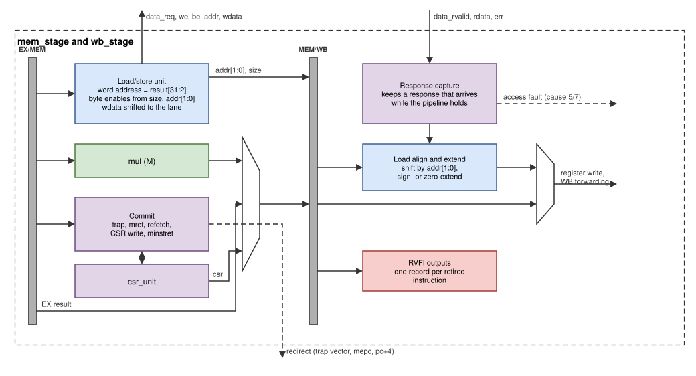

# Memory access (MEM) and write-back (WB)

MEM (`rtl/core/mem_stage.v`) is the *commit point* of the core: here
loads and stores are sent to the data port, multiplies produce their
product, CSR instructions read and write the CSRs, and traps, `mret` and
refetches take effect. WB (`rtl/core/wb_stage.v`) receives the load data,
aligns it, writes the register files and reports every retired instruction
on the RVFI port.

*Figure: MEM and WB. The data request leaves from MEM; the response
returns to WB.*

## Load/store unit (MEM)

From the address computed in EX (`result`) and the access size:

| Output | Value |
|---|---|
| `data_addr_o` | `{addr[31:2], 2'b00}` (word address) |
| `data_be_o` | byte: `0001 << addr[1:0]`; half: `0011 << addr[1:0]`; word: `1111` |
| `data_wdata_o` | store data shifted to its byte lane: `rs2 << (8 × addr[1:0])` |
| `data_we_o` | 1 for stores |

**Misaligned accesses** (a halfword at an odd address, a word at an address
not divisible by 4) are not sent. They raise a load- or store-address-
misaligned exception (cause 4 or 6, `mtval` = address).

**Request timing.** A request is raised only when WB is not waiting for the
previous response (or that response arrives in this cycle), which keeps at
most one request outstanding. While it is not granted, `mem_wait` holds the
whole pipeline.

## Multiplier (`mul.v`, M extension)

One signed 33 × 33-bit multiplication covers all four instructions: each
operand is extended by one bit, with its sign for signed operands and with 0
for unsigned ones.

| Instruction | a | b | Result |
|---|---|---|---|
| MUL | signed | signed | product bits 31:0 |
| MULH | signed | signed | bits 63:32 |
| MULHSU | signed | unsigned | bits 63:32 |
| MULHU | unsigned | unsigned | bits 63:32 |

The operands are the rs1/rs2 values that travelled through EX/MEM; the
product goes into MEM/WB. Vivado maps the multiplier onto four DSP48
blocks [[UG479]](references.md#fpga-and-boards).

## Commit

An instruction *commits* when it leaves MEM (MEM is valid, the pipeline does
not hold, and there is no access fault in WB). At that moment, if it does
not trap:

- a CSR instruction writes its CSR (the read value was taken in the same
  cycle and goes into MEM/WB as the result);
- its floating-point flags are OR-ed into `fflags`, and an FP register write
  sets `mstatus.FS` to Dirty;
- `minstret` counts it;
- `mret` restores `mstatus.MIE` and redirects to `mepc`;
- FENCE.I, or a write to `mstatus`, `mie`, `frm` or `fcsr`, redirects to
  `pc + 4` (a *refetch*), so that the following instructions are decoded
  with the new state.

If it traps, the CSR unit records the trap and the hazard unit redirects to
the trap vector ([CSRs and traps](core-csr-traps.md)).

## Write-back

**Response capture.** WB waits for the response of a load or store
(`wb_wait` holds the pipeline). A response that arrives while the pipeline
is held for another reason is kept in a register (`resp_q`) until WB can
use it.

**Load alignment.** The response word is shifted right by
`8 × addr[1:0]` and then sign- or zero-extended for LB/LBU (bits 7:0) and
LH/LHU (bits 15:0). FLW uses the same path and writes a float register.

**Access faults.** If the response carries `data_err_i`, the load or store
raises an access fault (cause 5 or 7, `mtval` = address) in WB. Because the
instruction in MEM is younger, it is discarded in the same cycle, and
`minstret` (which counted the faulting instruction when it left MEM) is
decremented again.

**Register write.** One write per cycle into the integer or float register
file: the aligned load data or the result from MEM/WB. The same value is
the WB forwarding source for EX.

## RVFI

WB drives the RISC-V Formal Interface (RVFI) [[RVFI]](references.md#risc-v-specifications): one record per retired
instruction with its PC, the next PC, the instruction word, register reads
and writes, the memory access with masks, trap and interrupt flags, and the
CSR access of CSR instructions. riscv-formal checks the core through it,
and the testbench turns it into a trace in Spike's format. Float register
writes and the accumulated `fflags` are reported on extra outputs
(`rvfi_frd_*`, `rvfi_fflags`) because RVFI has no float fields. An interrupt
carrier does not retire; the first instruction of the handler is reported
with `rvfi_intr = 1`. In the SoC the RVFI outputs are left unconnected and
removed by synthesis.

## Design decisions

**The multiplier in MEM.** A 32 × 32 multiplication after the forwarding
multiplexers in EX would be the critical path. In MEM it has a full cycle
for the DSP blocks, and the cost is one stall for an instruction that uses
the product immediately (a multiply is a late producer, like a load).

**CSRs commit in MEM.** Version 1 read CSRs in ID and wrote them in WB, so
an instruction could see a CSR value that an older instruction was still
about to change. Reading and writing in MEM, when the instruction is the
oldest that can still trap, keeps every CSR access in program order and
makes traps precise.

**Access faults in WB.** Bus errors are only known when the response
arrives. Taking them in WB and discarding the younger instruction in MEM
keeps them precise without holding MEM until every response is back.

**Flags travel with the instruction.** Version 1 overwrote `fflags` with
the flags of the last FP instruction. Version 2 carries each instruction's
flags down the pipeline and accumulates them at commit, so a CSR read of
`fflags` sees exactly the older instructions.
