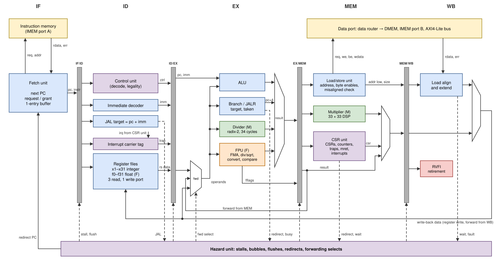

# Core

`hornet_core` (`rtl/core/hornet_core.v`) is an in-order, single-issue,
five-stage pipeline with precise traps. Each stage is its own module and
owns the pipeline register at its output; `hornet_core.v` only wires them
together with the hazard unit, the register files and the CSR unit.

| Stage | Module | Work | Output register |
|---|---|---|---|
| IF | `if_stage` | sends fetch requests, receives instructions | IF/ID |
| ID | `id_stage` | decodes, reads registers, resolves JAL, tags interrupts | ID/EX |
| EX | `ex_stage` | forwards operands; ALU, branches, divider, FPU | EX/MEM |
| MEM | `mem_stage` | sends data requests; multiplier; CSR access; commits traps | MEM/WB |
| WB | `wb_stage` | receives load data, writes registers, reports to RVFI | (register files) |
| — | `hazard_unit` | every stall, bubble, flush, redirect and forwarding select | — |
| — | `csr_unit` | CSRs, trap entry, `mret`, counters, interrupt arbitration | — |
| — | `regfile` | 31 integer and (with F) 32 float registers | — |

## ISA configurations

The parameters `RV_M` and `RV_F` decide which units exist. The pipeline,
the hazard unit and the integer datapath are the same in all three
configurations. An absent unit is not synthesised, and its instructions
raise an illegal-instruction exception.

| What changes | RV32I | RV32IM | RV32IMF |
|---|---|---|---|
| `div` in EX, `mul` in MEM | — | built | built |
| `fpu_top` in EX, float register file (32 × 32 bit, 3 read ports) | — | — | built |
| M instructions | illegal | executed | executed |
| F instructions, `fflags`/`frm`/`fcsr` | illegal | illegal | executed (when `mstatus.FS` ≠ Off) |
| `mstatus.FS` | read-only 0 | read-only 0 | writable, Off after reset |
| `misa` | `0x4000_0100` | `0x4000_1100` | `0x4000_1120` |
| GCC options (`make ISA=…`) | `-march=rv32i_zicsr_zifencei -mabi=ilp32` | `rv32im…`, `ilp32` | `rv32imf…`, `ilp32f` |

<!-- pdf: landscape -->

## Pipeline



*Figure: the complete pipeline (RV32IMF). Grey bars are the pipeline
registers. Solid lines carry data; dashed lines are requests to and commands
from the hazard unit. The forwarding paths run below the registers: the
value in MEM ("forward from MEM") and the write-back value ("forward from
WB", which is also the register-file write) return to the forwarding
multiplexers in EX.*

<!-- pdf: end landscape -->

## Latencies and penalties

EX takes each operand from the instruction in MEM, the instruction in WB or
the register file, newest first. Integer and float registers share the same
forwarding and stall logic, so dependencies between them cost the same as
between integer instructions.

| Instruction class | Cycles in EX | Result available to the next instruction |
|---|---|---|
| ALU, LUI, AUIPC | 1 | next cycle (forwarded from MEM) |
| load, CSR read, multiply | 1 | after one stall cycle (forwarded from WB) |
| DIV, DIVU, REM, REMU | 35 (2 for division by zero and overflow) | forwarded from MEM |
| FP sign injection, min/max, compare, classify, moves | 1 | forwarded from MEM |
| FADD, FSUB, FMUL, fused multiply-add | 6 | forwarded from MEM |
| FDIV, FSQRT | 30, 29 | forwarded from MEM |
| FCVT | 3 | forwarded from MEM |

| Event | Cycles lost | What happens |
|---|---|---|
| use of a load, multiply or CSR-read result by the next instruction | 1 | a bubble enters EX |
| JAL | 1 | redirect from ID |
| taken branch, JALR | 2 | redirect from EX (branches are predicted not taken) |
| trap, `mret`, refetch (FENCE.I, writes to `mstatus`, `mie`, `frm`, `fcsr`) | 3 | redirect from MEM |
| load or store access fault | 4 | redirect from WB |
| divider or multi-cycle FPU operation | until done | younger instructions wait, older ones complete |
| memory not granting or not answering | until it answers | the whole pipeline holds |

## Memory ports

The core has an instruction port and a data port. Both follow the same
request/grant/valid protocol, the address and response phases of OBI
[[OBI]](references.md#bus-and-peripheral-standards) without its optional signals:

```verilog
// instruction port
output        instr_req_o,
input         instr_gnt_i,
output [31:0] instr_addr_o,     // word-aligned
input         instr_rvalid_i,
input  [31:0] instr_rdata_i,
input         instr_err_i,
// data port
output        data_req_o,
input         data_gnt_i,
output        data_we_o,
output [3:0]  data_be_o,        // byte enables (lane-shifted)
output [31:0] data_addr_o,      // word-aligned
output [31:0] data_wdata_o,     // lane-shifted
input         data_rvalid_i,
input  [31:0] data_rdata_i,
input         data_err_i
```

1. A request (`req = 1` with address and data) stays stable until it is
   granted (`req && gnt` in the same cycle).
2. Every granted request receives exactly one response (`rvalid`), in
   order, at least one cycle after the grant.
3. At most one request is outstanding per port.
4. `err` with the response marks a failed access (bus error, unmapped
   address): an instruction access fault for the instruction port, a load
   or store access fault for the data port.

HORNET's memories always grant and answer one cycle later, but the core
works with any number of wait states; the verification runs every test with
random grant and response delays as well.

## Performance and resources

Cycles per instruction (CPI) measured on riscv-tests with block-RAM timing
(no wait states): total cycles divided by total retired instructions of
each suite, including the tests' own trap-handling code. The values are the
same in every configuration that runs the suite.

| Suite | CPI |
|---|---|
| rv32ui (integer) | 1.19 |
| rv32um (multiply/divide) | 1.47 |
| rv32uf (floating point) | 1.38 |
| rv32mi (machine mode, traps) | 1.43 |

Resources and clock on the Nexys 4 DDR (Artix-7 100T, Vivado 2025.2, 64 KB
IMEM and 64 KB DMEM, RV32IMF): 50 MHz with 0.85 ns slack; 6.6 k LUTs and
2.8 k flip-flops for the whole SoC, of which the core uses 6.0 k / 2.0 k
and EX with the FPU 4.0 k / 1.1 k; 6 DSP48 blocks (multiplier and FMA).

The critical path is a load result forwarded into a branch comparison whose
target then goes to the instruction memory in the same cycle.
