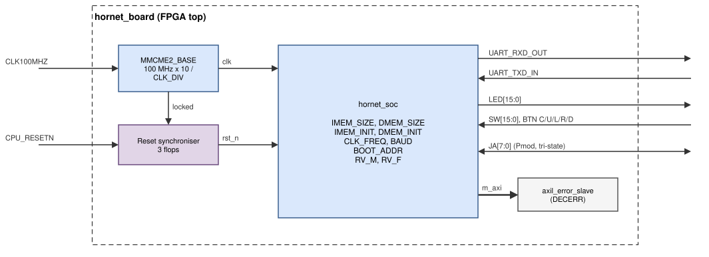
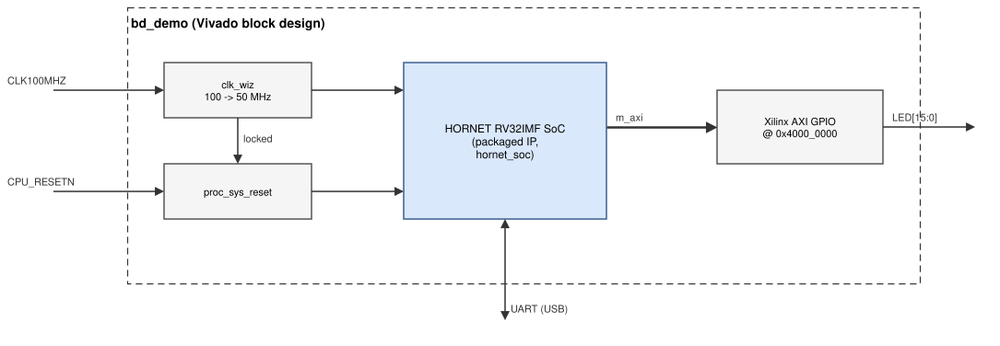

# FPGA implementation

HORNET runs on Digilent **Nexys 4 DDR** (Artix-7 `xc7a100tcsg324-1`)
[[NEXYS4DDR]](references.md#fpga-and-boards) and **Nexys Video** (Artix-7 `xc7a200tsbg484-1`)
[[NEXYSVIDEO]](references.md#fpga-and-boards) boards with Vivado 2025.2.
Everything for the FPGA is in `fpga/`. Other boards with a 100 MHz
oscillator need only a board definition and constraints.

## The board top



*Figure: `hornet_board`: clock generation, reset synchronisation, the SoC
and the board pins. The external AXI4-Lite port is terminated with a DECERR
responder.*

`fpga/common/hornet_board.v` is the top for every board:

- **Clock.** An `MMCME2_BASE` [[UG472]](references.md#fpga-and-boards) multiplies the 100 MHz board oscillator to a
  1000 MHz VCO and divides it by `CLK_DIV`: 20 → 50 MHz (default),
  24 → 41.7 MHz. `CLK_FREQ` of the SoC is computed from it, so the UART
  baud rate and `hornet_clk_freq()` are always right.
- **Reset.** The active-low CPU_RESET button and the MMCM `locked` signal
  go through a three-flip-flop synchroniser: reset is asserted
  asynchronously and released synchronously.
- **Pins.** `LED[N_LED-1:0] = gpio_o`, `gpio_i = {JA, 0, BTND, BTNR, BTNL,
  BTNU, BTNC, SW}`, the Pmod JA pins are tri-state with `gpio_oe[31:24]`, the
  UART goes to the board's USB-UART bridge.
- **Parameters.** `IMEM_SIZE`, `DMEM_SIZE`, `IMEM_INIT`, `DMEM_INIT`,
  `CLK_DIV`, `BAUD`, `BOOT_ADDR`, `N_LED`, `N_SW`, `RV_M`, `RV_F`.

| Board | `BOARD` | LEDs | Switches | UART | Notes |
|---|---|---|---|---|---|
| Nexys 4 DDR | `nexys4ddr` (default) | 16 | 16 | USB-UART on the PROG/UART port | |
| Nexys Video | `nexysvideo` | 8 | 8 | separate UART micro-USB port (FT232R) | switches and buttons are on the VADJ banks: the constraints use LVCMOS12, the default setting of jumper JP6 (1.2 V) |

## Files

| File | Purpose |
|---|---|
| `common/hornet_board.v` | board top (above) |
| `common/build.tcl` | batch flow: synthesis, implementation, reports, bitstream |
| `common/create_project.tcl` | GUI project |
| `common/program.tcl` | JTAG programming |
| `common/board.tcl` | loads a board definition and the program arguments |
| `<board>/board.tcl` | board name, FPGA part, JTAG device, constraints file, LED and switch counts |
| `<board>/<board>.xdc` | the pins used by the top, taken from Digilent's master file |
| `<board>/*-Master.xdc` | Digilent's master constraints, unchanged, for reference |
| `<board>/build.tcl`, `create_project.tcl`, `program.tcl` | the common scripts for this board, runnable from the Vivado GUI without arguments |
| `default/imem.hex`, `dmem.hex` | default images: bootloader + LED blink (`make fpga-default` regenerates them) |
| `ip/package_ip.tcl` | packages `hornet_soc` as a Vivado IP |
| `ip/bd_demo.tcl`, `bd_demo.xdc`, `ip/default/` | block-design demo with a Xilinx AXI GPIO |

## Four ways to a bitstream

| Way | Command | Result |
|---|---|---|
| Vivado GUI, no other tools | Tools → Run Tcl Script → `fpga/<board>/create_project.tcl` | `build/vivado-<board>/hornet.xpr` with the default images; Generate Bitstream |
| Make, batch | `make fpga-build BOARD=<board> FPGA_PROG=sw/examples/gpio` | `build/fpga/<board>/<isa>/gpio/hornet_<board>.bit`, reports |
| Make, GUI project for a program | `make fpga-project BOARD=<board> FPGA_PROG=…` | a project with that program's images |
| Vivado batch without Make | `vivado -mode batch -source fpga/<board>/build.tcl` | `build/vivado-batch-<board>/` with the default images |

`make fpga-program BOARD=<board> FPGA_PROG=…` (or `program.tcl`, or the
Hardware Manager) loads the bitstream over JTAG.

| `make fpga-build` option | Default | Meaning |
|---|---|---|
| `BOARD` | `nexys4ddr` | a directory `fpga/<BOARD>/` with `board.tcl` |
| `FPGA_PROG` | `sw/examples/gpio` | program directory; it is built for `ISA` and its memory sizes are used |
| `ISA` | `rv32imf` | core configuration (`RV_M`, `RV_F` generics) |
| `BOOTLOADER` | 0 | 1: add the UART bootloader at the top of IMEM and start there |
| `CLK_DIV` | the program's `CLK_DIV` (20) | core clock = 1000 MHz / `CLK_DIV` |

The batch flow prints `RESULT: WNS … ns at … MHz` and writes timing,
utilisation and power reports next to the bitstream. The program images
are the initial contents of the block RAMs, so a new program needs a new
bitstream, or the bootloader.

## Loading programs over the UART

```bash
make fpga-build FPGA_PROG=sw/examples/gpio BOOTLOADER=1
make fpga-program FPGA_PROG=sw/examples/gpio
# then press CPU_RESET on the board
python3 scripts/hornet_load.py --port /dev/ttyUSB1 --term \
    sw/tests/hello/build/hello.elf
```

Unattended (for example from a CI job or overnight benchmarks),
`make fpga-run` (`scripts/fpga_run.sh`) starts the loader in the Docker
image, programs the bitstream over JTAG (which resets the board into the
bootloader), and logs the UART output until a line contains `result `:

```bash
# FPGA_BIT: a bitstream built with BOOTLOADER=1
make fpga-run BOARD=nexysvideo FPGA_BIT=<bitstream> ELF=<prog.elf> \
    PORT=/dev/ttyUSB0 LOG=build/run.log
```

The program must be built with the same `IMEM_SIZE`/`DMEM_SIZE` as the
bitstream and must fit below the bootloader's areas; `make fpga-build
BOOTLOADER=1` reports an overlap.

## HORNET as a Vivado IP

```bash
# build/ip: IP "HORNET RV32IMF SoC" (vendor gstl.itu), with an m_axi interface
make fpga-ip
# block design with the IP and a Xilinx AXI GPIO, built to a bitstream
make fpga-bd
```

or, in the GUI: Tools → Run Tcl Script → `fpga/ip/bd_demo.tcl` (it packages
the IP when needed and stops after creating the block design).



*Figure: the block-design demo: HORNET drives a Xilinx AXI GPIO at
`0x4000_0000` through its `m_axi` port.*

The packaged IP follows [[UG1118]](references.md#fpga-and-boards), the demo uses AXI GPIO
[[PG144]](references.md#fpga-and-boards) in a block design [[UG994]](references.md#fpga-and-boards). To use the IP in your own
design: **Settings → IP → Repository** → add
`build/ip`; add "HORNET RV32IMF SoC"; set `IMEM_INIT`/`DMEM_INIT` to the
absolute paths of the program images, `CLK_FREQ` to the clock you connect,
the memory sizes and `RV_M`/`RV_F` if needed; connect `m_axi` to your
AXI4-Lite slaves (through an AXI SmartConnect for more than one) and give
them addresses in `0x4000_0000`–`0x7FFF_FFFF` in the Address Editor.

## Adding a board

Copy `fpga/nexysvideo/` to `fpga/<name>/`; in `board.tcl` set the part,
the JTAG device name and the LED/switch counts; in the `.xdc` map the ports
of `hornet_board` (`CLK100MHZ`, `CPU_RESETN`, `UART_TXD_IN`, `UART_RXD_OUT`,
`SW[]`, `BTN*`, `LED[]`, `JA[]`) to the board's pins; build with
`BOARD=<name>`. A board without a 100 MHz oscillator or with an active-high
reset needs a change of the MMCM settings or the reset polarity in
`hornet_board.v`.

## Results

Vivado 2025.2, default strategies, RV32IMF:

| Board | Build | Clock | Worst setup slack | LUTs | FFs | DSP | BRAM36 |
|---|---|---|---|---|---|---|---|
| Nexys 4 DDR | 64 KB + 64 KB (`sw/examples/gpio`) | 50 MHz | +0.85 ns | 6.6 k | 2.8 k | 6 | 32 |
| Nexys 4 DDR | default images (bootloader + LED blink) | 50 MHz | +0.98 ns | | | 6 | 32 |
| Nexys 4 DDR | block-design demo (HORNET + AXI GPIO) | 50 MHz | +0.94 ns | | | 6 | 32 |
| Nexys 4 DDR | 320 KB + 64 KB + bootloader (MLP example) | 41.7 MHz | +0.75 ns | 7.6 k | 3.3 k | 6 | 112 |
| Nexys Video | 256 KB + 256 KB + bootloader (PQC benchmarks) | 50 MHz | +0.46 ns | 7.0 k | 2.9 k | 6 | 128 |

At 50 MHz the MLP build misses timing by 0.53 ns: 112 of the 135 block RAMs
are spread over the device and the IMEM output multiplexers add delay, so
that example uses `CLK_DIV = 24`. The critical path of the default build is
a load result forwarded into a branch comparison whose target is sent to the
instruction memory in the same cycle ([Core](core.md#performance-and-resources)).
