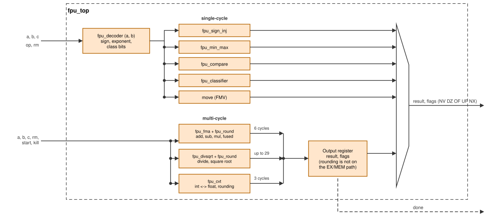
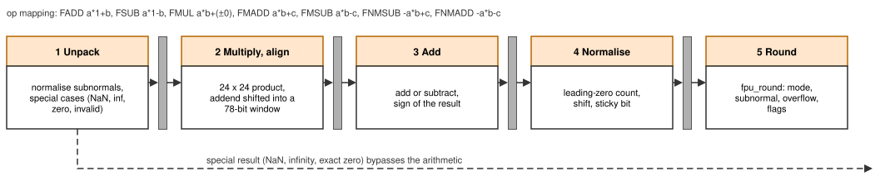
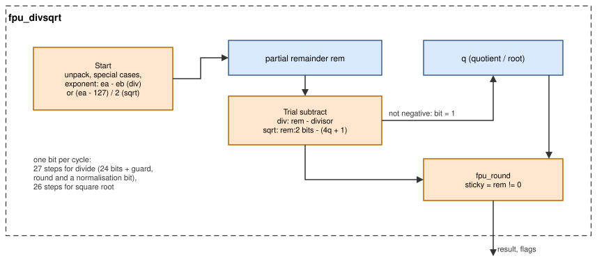
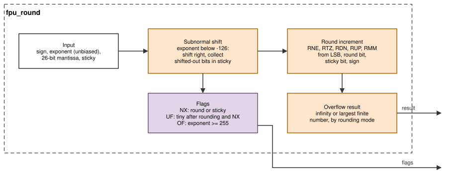

# Floating-point unit (FPU)

With `RV_F = 1` the core implements the RISC-V F extension: single-precision
(IEEE 754 binary32) arithmetic with 32 float registers. The FPU
(`rtl/fpu/`) sits in the EX stage. It is exact: every result and every
exception flag matches the IEEE 754-2008 standard [[IEEE754]](references.md#arithmetic) as the
RISC-V F specification [[RV-UNPRIV]](references.md#risc-v-specifications) requires it, for all five rounding modes and for subnormal
numbers, as checked against 4.27 million TestFloat vectors
[[TESTFLOAT]](references.md#arithmetic). What software
sees (rounding modes, flags, NaNs, conversion limits) is summarised in
[Programmer's model: floating point](programming.md#floating-point); this
chapter explains how the units compute it. Background on floating-point
arithmetic and its hardware is in [[GOLDBERG]](references.md#arithmetic) and [[MULLER]](references.md#arithmetic).

## Floating-point numbers in short

A binary32 number has a sign `s`, an 8-bit exponent field `e` and a 23-bit
fraction `f`:

| `e` | Value | Name |
|---|---|---|
| 1–254 | (−1)^s × 1.f × 2^(e−127) | normal number |
| 0, f ≠ 0 | (−1)^s × 0.f × 2^(−126) | subnormal (very small) number |
| 0, f = 0 | ±0 | zero |
| 255, f = 0 | ±∞ | infinity |
| 255, f ≠ 0 | NaN (f[22] = 1: quiet, 0: signalling) | not a number |

A result that is not exactly representable is **rounded** to one of its two
neighbours; the rounding mode (`rm`, or `frm` for dynamic rounding) chooses
which. Every operation can also raise five **flags**: NV (invalid
operation), DZ (division by zero), OF (overflow), UF (underflow) and NX
(inexact). Rounding and flags are what most FPU bugs are about, and what
most of the logic below is for.

## Structure

*Figure: `fpu_top`. Single-cycle operations are combinational; the
multi-cycle units start on `start` and are cancelled by `kill`. Their result
is registered once more before it leaves EX.*

| Module | Operations | Cycles in EX |
|---|---|---|
| `fpu_sign_inj` | FSGNJ, FSGNJN, FSGNJX (also FMV, FNEG, FABS) | 1 |
| `fpu_min_max` | FMIN, FMAX | 1 |
| `fpu_compare` | FEQ, FLT, FLE | 1 |
| `fpu_classifier` | FCLASS | 1 |
| moves in `fpu_top` | FMV.X.W, FMV.W.X | 1 |
| `fpu_fma` + `fpu_round` | FADD, FSUB, FMUL, FMADD, FMSUB, FNMSUB, FNMADD | 6 |
| `fpu_divsqrt` + `fpu_round` | FDIV, FSQRT | 30, 29 |
| `fpu_cvt` | FCVT.W.S, FCVT.WU.S, FCVT.S.W, FCVT.S.WU | 3 |
| (load/store unit) | FLW, FSW | as integer loads and stores |

`fpu_decoder` splits each operand into sign, exponent and significand and
classifies it (zero, subnormal, infinity, NaN, signalling); the single-cycle
units use these fields.

**Interface to EX.** `start` is raised in the first EX cycle of a
multi-cycle operation (with the operands captured by EX), `done` when the
result is ready, and `kill` when the instruction leaves EX (it completes or
a trap flushes it); `kill` returns every unit to idle.

## Fused multiply-add (`fpu_fma.v`)

One unit computes `a × b + c` with a **single rounding** at the end. The
other arithmetic operations are mapped onto it:

| Instruction | Computed as |
|---|---|
| FADD a, b | a × 1.0 + b |
| FSUB a, b | a × 1.0 + (−b) |
| FMUL a, b | a × b + (±0), the zero having the product's sign |
| FMADD | a × b + c |
| FMSUB | a × b − c |
| FNMSUB | −(a × b) + c |
| FNMADD | −(a × b) − c |

*Figure: the five steps of the FMA, one per cycle, with registers between
them.*

1. **Unpack.** Subnormal operands are normalised: their significand is
   shifted left until bit 23 is 1, and the exponent is lowered accordingly
   (a leading-zero count). Special cases are decided here: a NaN operand,
   an invalid operation (∞ × 0, ∞ − ∞, a signalling NaN) → canonical NaN with
   NV; an infinite product or addend → ∞; zero products → the addend, or a
   signed zero by the IEEE rules (−0 only when both are −0, or in RDN for an
   exact zero sum). These results bypass the arithmetic.
2. **Multiply and align.** The 24 × 24-bit significands give a 48-bit
   product. The addend's significand is shifted to the product's exponent
   inside a 78-bit window (wide enough for the product, the addend and the
   guard bits); bits shifted out of the window are OR-ed into a sticky bit.
   If the addend is much larger than the product, the product only
   contributes a sticky bit.
3. **Add.** The two values are added, or subtracted when their signs
   differ; a negative difference is negated and the sign flips. An exact
   zero result is noted.
4. **Normalise.** A leading-zero count over the 78-bit sum shifts it so
   that the leading one is at the top; the exponent is adjusted, and the
   bits below the 26 kept bits form the sticky bit.
5. **Round** with `fpu_round` (below).

## Divide and square root (`fpu_divsqrt.v`)

*Figure: one quotient or root bit per cycle.*

Both are digit-recurrence algorithms that produce one result bit per cycle,
the floating-point counterparts of the integer divider:

- **Division** `a / b`: after unpacking (subnormals normalised), the
  exponent is `ea − eb`, and the significands go through a restoring
  division: subtract the divisor from the partial remainder; if the result
  is not negative, keep it and write a 1, otherwise keep the old remainder
  and write a 0; shift left. 27 steps give 24 significant bits, a
  normalisation bit and the guard and round bits.
- **Square root** `√a`: the exponent is halved (an odd exponent first
  moves one bit into the significand). The root is built bit by bit with
  the classic pencil-and-paper method: bring down two bits of the radicand,
  try to subtract `4 × root + 1`; if that is not negative, the next root bit
  is 1. 26 steps.
- The remainder after the last step tells whether the result is exact; if
  not, the sticky bit is set. `fpu_round` then rounds.
- Special cases are decided at the start: NaN operands, 0/0 and ∞/∞ (NV),
  x/0 (DZ, ±∞), 0/x and x/∞ (±0), √ of a negative number (NV), √±0 = ±0,
  √+∞ = +∞.

## Rounding (`fpu_round.v`)

`fpu_round` takes a sign, an unbiased exponent, a 26-bit significand with
the leading one at the top (24 result bits, a round bit and one more bit)
and a sticky bit, and produces the binary32 result and the OF, UF and NX
flags.

1. **Subnormal results.** If the exponent is below −126, the significand is
   shifted right until the exponent is −126; the bits shifted out are
   collected in the sticky bit.
2. **Round increment.** With `lsb` the last kept bit, `r` the round bit
   and `st` the sticky bit:

   | Mode | Increment when |
   |---|---|
   | RNE | `r & (st \| lsb)` |
   | RTZ | never |
   | RDN | negative and `r \| st` |
   | RUP | positive and `r \| st` |
   | RMM | `r` |

   Adding the increment to `{exponent, fraction}` as one integer handles a
   carry into the exponent (1.111… rounding up to 10.000…) and a subnormal
   rounding up to the smallest normal number automatically.
3. **Overflow.** If the exponent is 255 or more after rounding, the result
   is ∞ (RNE, RMM, and RDN/RUP in the direction of the sign) or the largest
   finite number (RTZ, and RDN/RUP against the sign), with OF and NX.
4. **Flags.** NX when `r` or `st` is set (or on overflow). UF when the
   result is *tiny* and inexact; tininess is detected **after rounding**, as
   RISC-V specifies: a value just below the smallest normal number that
   rounds up to it is not tiny.

## Conversions (`fpu_cvt.v`)

- **Float → integer** (FCVT.W.S, FCVT.WU.S): the significand is shifted by
  the exponent; the bits shifted out give the round and sticky bits, and
  the same rounding rule is applied to the integer. Out-of-range values,
  ∞ and NaN return the saturated values listed in
  [Programmer's model: floating point](programming.md#floating-point).

- **Integer → float** (FCVT.S.W, FCVT.S.WU): the absolute value is
  normalised with a leading-zero count; values with more than 24
  significant bits are rounded by `fpu_round` (NX).

## Single-cycle operations

| Operation | Rule | Flags |
|---|---|---|
| FSGNJ/N/X | result = a with the sign of b, of ¬b, or of a ⊕ b | none |
| FMIN, FMAX | the smaller/larger; −0 < +0; one NaN operand → the other operand; two NaNs → canonical NaN | NV for a signalling NaN |
| FEQ | 1 if equal (+0 = −0); 0 for NaN | NV for a signalling NaN |
| FLT, FLE | ordered comparison; 0 for NaN | NV for any NaN |
| FCLASS | one-hot 10-bit class: −∞, −normal, −subnormal, −0, +0, +subnormal, +normal, +∞, sNaN, qNaN | none |
| FMV.X.W, FMV.W.X | bit copy between the register files | none |

## Design decisions

**Every FP operation in EX.** Like the divider, the FPU runs in EX; a
multi-cycle operation holds the younger instructions while older ones
drain. This keeps one forwarding and stall mechanism for all units.

**One FMA for add, subtract and multiply.** Version 1 had no fused
multiply-add: the four fused instructions were illegal and programs had to be
compiled with `-ffp-contract=off`. A single FMA unit implements all seven
operations with one rounding, so GCC's default code works and the area of
separate adder and multiplier datapaths is saved.

**Registered results.** Version 1's single-cycle adder sat behind the
forwarding multiplexers in EX and was the critical path of the core. In
version 2 every multi-cycle unit registers its result once more in
`fpu_top`, so rounding logic is never on the path into EX/MEM.

**Iterative divide and square root.** One bit per cycle is small and easy to
verify; FDIV and FSQRT are rare in the target programs (filters, neural
networks), where FMA dominates.

**Full IEEE behaviour, no flush-to-zero.** Subnormal inputs and outputs,
all rounding modes and all flags are implemented, because the RISC-V F
specification requires them and the RISCV-DV environment of version 1 found
exactly these corner cases wrong (dynamic rounding, guard/round/sticky in
RTZ/RDN/RUP, overflow and underflow rounding, subnormal division and square
root).

**Old units kept where they were correct.** The classifier, sign injection,
min/max and compare units of version 1 pass every vector and were kept
unchanged; the arithmetic units were replaced.
