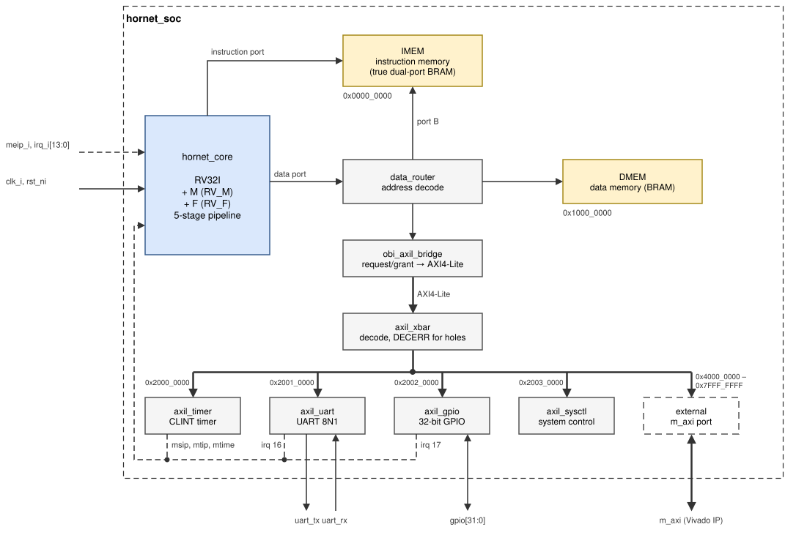

# Introduction

HORNET is a 32-bit RISC-V processor core and a small system-on-chip (SoC)
around it, designed at Istanbul Technical University (ITU) in the GSTL
laboratory. It implements the RISC-V ISA [[RV-UNPRIV]](references.md#risc-v-specifications) [[RV-PRIV]](references.md#risc-v-specifications), is written
in plain Verilog-2005 [[VERILOG]](references.md#hardware-description-languages), runs bare-metal C programs,
and is built for teaching and research: students use it in simulation, on
Digilent Artix-7 boards, and as an IP block in Vivado block designs.

This manual describes **version 2** of HORNET (2026). Every number in it
can be reproduced from the repository.

## Two manuals

The same chapters are built into two PDF manuals (`make docs`):

| Manual | For |
|---|---|
| **HORNET manual** (`hornet-manual.pdf`): Part I, *Using HORNET* | engineers who want to run, program or integrate HORNET and get on with their work: setup, interfaces, programmer's model, register maps, software, FPGA flow, verification results |
| **HORNET student's manual** (`hornet-student-manual.pdf`): Part I and Part II, *Inside HORNET* | students, and anyone who wants to learn how a RISC-V processor is built: how every block works, its algorithms, how it is verified, why it is designed the way it is, and what changed from version 1 |

## What HORNET is

| Item | Version 2 |
|---|---|
| Instruction set | RV32I, RV32IM or RV32IMF, each with Zicsr and Zifencei; chosen by two parameters (`RV_M`, `RV_F`) |
| Privilege | machine mode only (M-mode), precise traps, interrupts |
| Pipeline | five stages (IF, ID, EX, MEM, WB), in order, one instruction per cycle at best |
| Integer multiply/divide (M) | multiplier in MEM (FPGA DSP blocks), iterative radix-2 divider in EX |
| Floating point (F) | IEEE 754 binary32: fused multiply-add, divide, square root, conversions, compare; all rounding modes, subnormal numbers and exception flags |
| Memory | Harvard: separate instruction and data block RAMs (64 KB each by default), no caches |
| Bus | AXI4-Lite for peripherals, with an external AXI4-Lite master port for Vivado IP |
| Peripherals | CLINT-style timer, UART with FIFOs, 32-bit GPIO, system control |
| FPGA | Nexys 4 DDR (Artix-7 100T) and Nexys Video (Artix-7 200T); 50 MHz |
| Verification | Spike co-simulation, random programs, RISCV-DV, TestFloat, riscv-formal, SoC test programs |

*Figure: the HORNET SoC. The core has an instruction port to the
instruction memory and a data port that reaches the data memory, the second
port of the instruction memory and the AXI4-Lite peripherals.*

## Three ISA configurations

The same RTL builds three cores. The base integer ISA (RV32I) is always
present; the M and F extensions are switched on with the parameters `RV_M`
and `RV_F` of `hornet_core`, `hornet_soc` and the FPGA top. Without an
extension its hardware is not built at all, its instructions raise an
illegal-instruction exception, and the `misa` register does not report it.
[Core](core.md#isa-configurations) lists what changes between them.

| Configuration | `RV_M` | `RV_F` | `misa` | Typical use |
|---|---|---|---|---|
| RV32I | 0 | 0 | `0x4000_0100` | smallest core; control code |
| RV32IM | 1 | 0 | `0x4000_1100` | integer signal processing, cryptography |
| RV32IMF | 1 | 1 | `0x4000_1120` | floating-point and machine-learning work (default) |

`make ... ISA=rv32i|rv32im|rv32imf` selects the configuration for every flow:
simulation, tests, formal verification, software and the FPGA build.

## Repository and versions

| What | Where |
|---|---|
| Source code | [GSTL-ITU/HORNET-RV32IMF](https://github.com/GSTL-ITU/HORNET-RV32IMF) on GitHub |
| Version 2 (this manual) | branch [`main`](https://github.com/GSTL-ITU/HORNET-RV32IMF/tree/main), release [`v2.0.0`](https://github.com/GSTL-ITU/HORNET-RV32IMF/releases/tag/v2.0.0) |
| Version 1 (unmaintained) | branch [`legacy`](https://github.com/GSTL-ITU/HORNET-RV32IMF/tree/legacy), release [`v1.2.0`](https://github.com/GSTL-ITU/HORNET-RV32IMF/releases/tag/v1.2.0) |
| The PDF manuals of each release | [Releases](https://github.com/GSTL-ITU/HORNET-RV32IMF/releases) |
| Bug reports and questions | [Issues](https://github.com/GSTL-ITU/HORNET-RV32IMF/issues) |

`git clone https://github.com/GSTL-ITU/HORNET-RV32IMF.git` gets version 2; add `--branch legacy` for version 1.

## How to read this manual

| If you want to … | Read |
|---|---|
| run HORNET now | [Quick start](quick-start.md) |
| understand the repository and the tools | [Repository and environment](repository.md) |
| integrate the SoC or the core | [SoC](soc.md), [Core](core.md) |
| write programs | [Programmer's model](programming.md), [Peripherals](peripherals.md), [Software](software.md) |
| build for an FPGA or use HORNET in a block design | [FPGA](fpga.md) |
| know how it is verified, or verify a change | [Verification](verification.md) |
| know how a block works inside and why | Part II of the student's manual |

### Conventions

- Signal and register names are written `like_this`; hexadecimal numbers
  are written `0x1000_0000` (the underscore only groups digits).
- *Cycle* means one clock cycle of the core clock.
- Figures draw the main data paths as solid lines and control signals
  (stalls, redirects, busy, interrupt requests) as dashed lines. Colours mark
  the kind of block: blue integer datapath, green M extension, orange F
  extension, purple control, yellow memories, grey bus and peripherals, red
  tools and references. Dashed grey blocks are not built in that
  configuration.
- The figures are draw.io files in `docs/figures/`; they can be edited
  with draw.io desktop or its VS Code extension.
