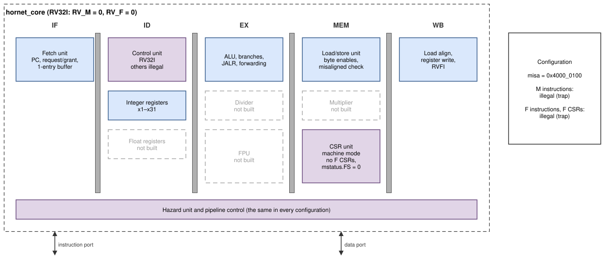
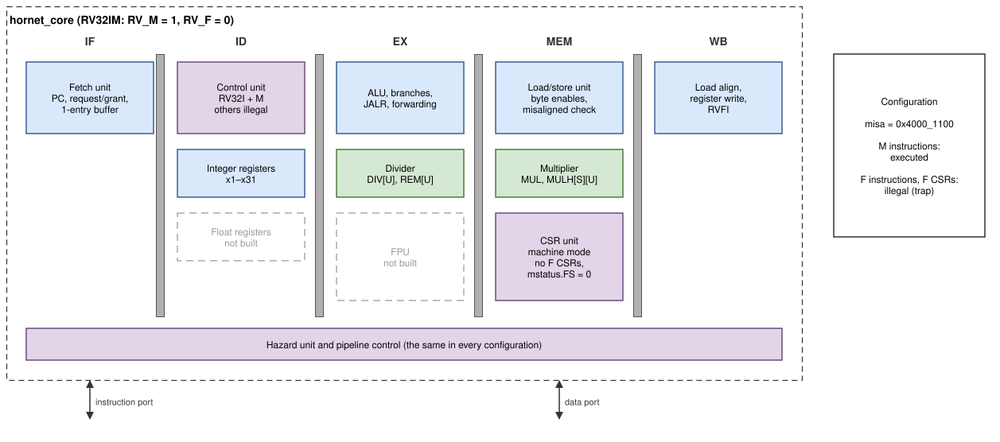
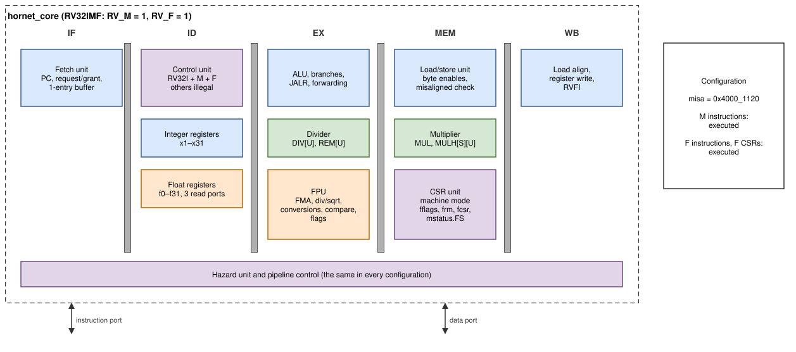

# The pipeline

The five-stage pipeline, hazards and forwarding are explained in
general in [[PH]](references.md#books). This chapter explains how instructions move
through the five stages of
`hornet_core`, how the hazard unit keeps them correct, and why the
pipeline is built this way. The stage table, the pipeline figure and the
latencies are in [Core](core.md); the following chapters describe each
stage.

## The three configurations

The pipeline, the hazard unit and the integer datapath are the same in all
three configurations; only the units below change.

*Figure: RV32I (`RV_M = 0`, `RV_F = 0`). No divider, multiplier, FPU or
float register file; M and F instructions and the F CSRs are illegal.*

*Figure: RV32IM (`RV_M = 1`, `RV_F = 0`). The divider in EX and the
multiplier in MEM are added.*

*Figure: RV32IMF (`RV_M = 1`, `RV_F = 1`, the default). The FPU in EX, the
float register file and the F CSRs (`fflags`, `frm`, `fcsr`,
`mstatus.FS`) are added.*

Removing a unit is done with `generate` blocks: the instance is replaced by
constants (`done = 1`, result 0), and the decoder marks the instructions
illegal, so no logic of the unit is synthesised.

## Walking an instruction through the pipeline

Take `lw x5, 8(x6)` followed by `add x7, x5, x5`:

1. **IF.** The fetch unit requests the address of the `lw` from IMEM; the
   word arrives in the next cycle and enters IF/ID with its PC.
2. **ID.** The control unit decodes a load; the immediate decoder extracts
   8; the register file reads `x6`. All of this goes into ID/EX.
3. **EX.** The forwarding multiplexers pick the newest value of `x6`; the
   ALU adds 8 and the address goes into EX/MEM. The `add` is in ID now. It
   needs `x5`, which a load only produces in WB, so the hazard unit stalls
   the `add` for one cycle (a *load-use* stall) and sends a bubble into EX.
4. **MEM.** The load/store unit makes a word address and byte enables and
   sends the request on the data port.
5. **WB.** The data arrives, is shifted and sign-extended, and is written
   into `x5`. In the same cycle the `add`, now in EX, receives the value
   through the WB forwarding path.

## Pipeline registers and valid bits

Every pipeline register carries a `valid` bit. A bubble is simply
`valid = 0`, and every side effect (register write, memory request, CSR
write, trap, redirect) is gated by it. Each register follows three rules:

| Command | Effect |
|---|---|
| flush | `valid ← 0` (the instruction is removed) |
| hold (stall) | contents stay |
| bubble | the next register gets `valid = 0`, this one holds |

Flush beats hold. Control fields of an instruction that will not execute
(an interrupt carrier, a faulting fetch, an illegal instruction) are
cleared already in ID, so they cannot cause side effects later.

## Hazards

All hazard decisions are made in one combinational block,
`hazard_unit.v`. It looks at the register addresses in ID and EX, the
destinations in EX, MEM and WB, and the status of each stage.

### One register namespace

An operand is identified by `{is_float, index}`. Integer and float
registers go through the same forwarding and stall logic, so an `fadd`
that reads the result of an `flw`, or an `fmv.x.w` whose result feeds an
`addi`, are handled exactly like integer dependencies. `x0` is never
forwarded and never causes a stall; `f0` is an ordinary register.

### Forwarding

EX takes each operand (rs1, rs2 and, for fused multiply-add, rs3) from one
of three places, newest first:

| Select | Source | Condition |
|---|---|---|
| 1 | EX/MEM result (instruction in MEM) | MEM writes this register |
| 2 | write-back value (instruction in WB) | WB writes this register |
| 0 | ID/EX (register file value) | otherwise |

The register files write on the rising clock edge and bypass a write to a
read of the same register in the same cycle, so an instruction that is in
ID while its producer is in WB reads the new value without forwarding.

### Stalls

| Situation | Penalty | Mechanism |
|---|---|---|
| *Late producer* in EX: load, multiply or CSR read, and the instruction in ID uses its result | 1 cycle | IF/ID holds, a bubble enters EX; the value is forwarded from WB afterwards |
| Divider or multi-cycle FPU operation not finished | until done | IF/ID and ID/EX hold, EX/MEM receives bubbles, older instructions drain |
| A memory request in MEM is not granted, or a response in WB has not arrived | until it arrives | the whole pipeline holds |

Multiplies, loads and CSR reads are late because their results are only
available in MEM/WB: the multiplier sits in MEM (to give the DSP blocks a
full cycle), load data arrives in WB, and CSRs are read when the
instruction commits in MEM.

### Redirects

A *redirect* replaces the fetch address. Four sources exist; the oldest
instruction wins:

| Priority | Source | When | Flushes | Penalty |
|---|---|---|---|---|
| 1 | WB | load/store access fault | IF/ID, ID/EX, EX/MEM, MEM | 4 |
| 2 | MEM | trap, `mret`, refetch after FENCE.I or a write to `mstatus`, `mie`, `frm`, `fcsr` | IF/ID, ID/EX, EX/MEM | 3 |
| 3 | EX | taken branch, JALR | IF/ID, ID/EX | 2 |
| 4 | ID | JAL | IF/ID | 1 |

Branches are predicted *not taken*: the instructions after a branch are
fetched and removed only if it is taken. The redirect target goes to the
instruction memory in the same cycle in which it is computed. The fetch
unit also needs `target + 4` for its next request, so EX computes it in
parallel instead of adding 4 afterwards.

## Timing examples

Each column is one clock cycle; the stage name says where the instruction
is at the end of that cycle.

**Load-use stall:**

| | 1 | 2 | 3 | 4 | 5 | 6 | 7 |
|---|---|---|---|---|---|---|---|
| `lw x5, 8(x6)` | IF | ID | EX | MEM | WB | | |
| `add x7, x5, x5` | | IF | ID | ID (stall) | EX ← WB | MEM | WB |
| `sub x8, x1, x2` | | | IF | IF (stall) | ID | EX | MEM |

**Taken branch (resolved in EX, two bubbles):**

| | 1 | 2 | 3 | 4 | 5 | 6 |
|---|---|---|---|---|---|---|
| `beq x1, x2, L` | IF | ID | EX → redirect | MEM | WB | |
| next instruction | | IF | ID ✗ | | | |
| next + 4 | | | IF ✗ | | | |
| `L:` target | | | | IF | ID | EX |

**JAL (resolved in ID, one bubble):**

| | 1 | 2 | 3 | 4 | 5 |
|---|---|---|---|---|---|
| `jal ra, f` | IF | ID → redirect | EX | MEM | WB |
| next instruction | | IF ✗ | | | |
| `f:` target | | | IF | ID | EX |

**Multi-cycle unit (divider):** a `div` stays 35 cycles in EX (2 for a
division by zero or `−2^31 / −1`); instructions in MEM and WB complete
meanwhile, and the following instructions wait in IF/ID and ID.

## Design decisions

**Five stages, in order, no branch predictor.** The pipeline follows the
classic textbook structure [[PH]](references.md#books) [[HH]](references.md#books) so that students can
map it to what they learn. A branch predictor was not added: with branches resolved in EX the
penalty is two cycles, and the measured CPI of 1.19 on integer code leaves
little to gain for the added complexity.

**One hazard unit.** Version 1 generated stalls and flushes in five places
(CSR unit, hazard unit, multiplier/divider, FPU, load/store unit), with
different rules; under some stall patterns interrupts were lost or taken
twice. Version 2 computes every stall, bubble, flush and redirect in one
module, with one priority order.

**Rising-edge register files with a bypass.** Version 1 wrote the register
files on the falling clock edge, which gave write-back and decode half a
cycle each and was one reason for its 26 MHz clock. Version 2 writes on the
rising edge and bypasses the write value to a read of the same register.

**JAL in ID, branches in EX.** JAL has no condition and no register
operand, so its target is known in ID and costs one cycle instead of two.
Branches need forwarded operands and are resolved in EX.

**MEM issues, WB receives.** The data request leaves the core from MEM,
and the response is received in WB. This gives the memory a full cycle
and keeps the address path short. A waiting port holds the whole pipeline,
which is simple and correct for any wait-state pattern.

**Misaligned accesses trap.** Version 1 split a misaligned load or store
into two bus accesses; a trap or interrupt between them left it half done.
Version 2 raises a misaligned exception (cause 4 or 6) instead, as the
RISC-V specification allows. GCC is called with `-mstrict-align`, so
compiled code never produces misaligned accesses.

**Registered redirects were not used.** The critical path of the core is a
load result forwarded into a branch comparison whose target then goes to
the instruction memory in the same cycle. Registering the redirect would
allow a faster clock at the price of one more cycle per taken branch.
