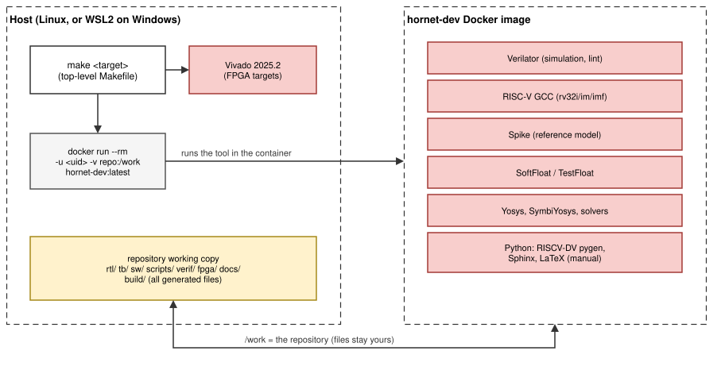
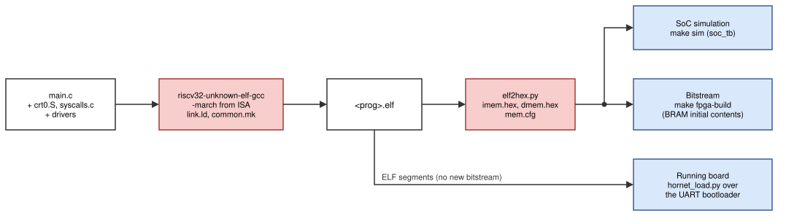

# Repository and environment

This chapter explains how the repository is organised, how one `make`
command reaches the right tool, where results go, and how the development
environment is set up. Everything in the repository is driven from the
top-level `Makefile`; nothing depends on files outside the repository
except Docker and, for the FPGA, Vivado.

## Directory layout

| Directory | Contents |
|---|---|
| `rtl/core/` | the core: pipeline stages, decoder, register files, hazard unit, CSR unit, ALU, multiplier, divider; `hornet_defs.vh` holds the shared opcodes, cause codes and CSR addresses |
| `rtl/fpu/` | the floating-point unit: FMA, divide/square root, conversions, rounding, compare, min/max, sign injection, classify |
| `rtl/soc/` | the SoC: instruction and data memories, data router, request-to-AXI bridge, AXI4-Lite interconnect, timer, UART, GPIO, system control |
| `rtl/lint.vlt` | Verilator lint waivers (each one with its reason) |
| `tb/` | testbenches: `hornet_tb.sv` (core), `soc_tb.sv` (SoC), `fpu_tb.sv` (FPU) |
| `verif/` | riscv-tests, riscv-formal and RISCV-DV (Git submodules), the formal wrapper and check list (`formal/`), the RISCV-DV test list, core setting and custom tests (`dv/`) |
| `scripts/` | Python and shell scripts: test runners, Spike comparison, random program generator, FPU vector generators, ELF-to-memory-image converter, UART loader, RISCV-DV driver, formal runner, figure export |
| `sw/` | startup code, linker script, newlib system calls, drivers, build rules (`common.mk`), UART bootloader, SoC test programs, examples |
| `fpga/` | board top (`common/hornet_board.v`), Vivado scripts, board definitions and constraints (`nexys4ddr/`, `nexysvideo/`), default memory images, IP packaging and block-design demo (`ip/`) |
| `docker/` | `Dockerfile` of the tool image and its Python requirements |
| `.devcontainer/` | VS Code Dev Container definition (the same image) |
| `docs/` | the manuals: Markdown chapters, draw.io figures (`figures/`), Sphinx configuration (`conf.py`) |
| `build/` | everything generated (not in Git): simulators, test logs, program images, bitstreams, the PDF |

## How a `make` command runs



*Figure: on the host, `make` wraps each tool call in `docker run`; the
repository is mounted at `/work` with the user's own UID, so all files stay
owned by the user. Vivado runs on the host.*

The top-level `Makefile` defines one variable, `DOCKER_RUN`, that is put in
front of every tool call:

```make
ifdef HORNET_CONTAINER          # set inside the image
DOCKER_RUN  =
else
DOCKER_RUN  = docker run --rm -t --memory=$(MEMLIM) -u $(id -u):$(id -g) \
              -v $(CURDIR):/work -w /work $(IMAGE)
endif
```

So `make cosim` on the host starts a container for the Verilator build, one
for the test runner, and so on; inside the image (`make shell`, the Dev
Container, a CI job) the same targets call the tools directly. The memory
limit (`MEMLIM`, default 8 GB) and the number of parallel jobs (`JOBS`,
default 4) keep a laptop usable.

The program build rules in `sw/common.mk` do the same for the compiler, so a
program directory can be built on its own (`make -C sw/examples/gpio`).
Programs outside the repository include `common.mk` by its path; the
container then also mounts their directory (`SRC_ROOT`).

Vivado is not in the image (it is large and licensed per host). The FPGA
targets call it on the host (`VIVADO`, default: `vivado` in `PATH` or
`/opt/Xilinx/2025.2/Vivado/bin/vivado`) and use the image only to build the
program images.

### The ISA variable

`ISA=rv32i|rv32im|rv32imf` (default `rv32imf`) is translated into the
parameters `RV_M` and `RV_F` (Verilator `-G` options, Vivado generics,
riscv-formal configuration) and into the compiler options
`-march=<ISA>_zicsr_zifencei -mabi=ilp32[f]`. Every result goes to a
directory named after the ISA, so the three configurations never overwrite
each other.

### Build directories

| Path | Contents |
|---|---|
| `build/sim/core-<isa>/` | Verilator model of the core testbench |
| `build/sim/soc-<isa>-<imem>-<dmem>-<boot>/` | Verilator model of the SoC testbench for one memory layout |
| `build/sim/fpu/` | FPU testbench |
| `build/fpu/` | FPU vectors and results |
| `build/<isa>/tests/`, `tests-stall/` | riscv-tests runs (one directory per test with ELF, logs, traces) and `summary.txt` |
| `build/<isa>/random/`, `random-stall/` | random programs and results |
| `build/<isa>/riscv-dv/` | RISCV-DV programs, logs, CSV traces, `summary.txt`, `results.csv` |
| `build/formal-<isa>/` | riscv-formal checks and `summary.txt` |
| `build/<isa>/sw-tests/` | SoC test program summary (logs in `sw/tests/<name>/build/<isa>/`) |
| `build/fpga/<board>/<isa>/<program>/` | Vivado batch build: bitstream, reports, log |
| `build/ip/`, `build/fpga/bd/` | packaged IP, block-design demo |
| `build/docs/` | the two PDF manuals and the HTML version |
| `sw/**/build/` | per-program ELF, listing, map, memory images |

`make clean` removes `build/`.

## Submodules

| Path | Repository | Used by |
|---|---|---|
| `verif/riscv-tests` | riscv-software-src/riscv-tests | `make test`, `cosim`, `cosim-stall` |
| `verif/riscv-formal` | YosysHQ/riscv-formal | `make formal` |
| `verif/riscv-dv` | chipsalliance/riscv-dv | `make riscv-dv` |

They are used unmodified; the targets fetch them on first use. HORNET's own
files for them (the formal wrapper, the RISCV-DV core setting and test list)
are in `verif/formal/` and `verif/dv/`.

## The tool image

`docker/Dockerfile` builds `hornet-dev:latest` on Ubuntu 24.04. Versions are
pinned so that every machine gets the same results:

| Tool | Version | Role |
|---|---|---|
| Verilator | 5.046 | simulation of the core, SoC and FPU testbenches; lint |
| RISC-V GCC (xPack) | 15.2.0 | `riscv32-unknown-elf-gcc` with newlib, multilibs for `rv32i`, `rv32im`, `rv32imf` |
| Spike | commit `fdc1ffa` | the RISC-V reference simulator for co-simulation |
| SoftFloat / TestFloat | 3e, RISC-V specialisation | reference vectors for the FPU |
| OSS CAD Suite | 2026-09-20 | Yosys, SymbiYosys and the SMT solvers for riscv-formal |
| Python 3 | Ubuntu 24.04, virtual env. `/opt/venv` | scripts; `pyelftools`, `pyserial`; RISCV-DV pygen (`pyvsc`, …); Sphinx, MyST |
| TeX Live (XeLaTeX) | Ubuntu 24.04 | the PDF manual |

`make docker-build` builds it (`JOBS` sets the compile parallelism),
`make tool-versions` prints the versions in use, and `make shell` opens an
interactive shell in it.

### VS Code Dev Container

`.devcontainer/devcontainer.json` builds the same image, maps the
container user to the host user's UID, limits memory to 8 GB, initialises
the submodules and installs the Verilog, Python, Makefile, draw.io and YAML
extensions. After **Reopen in Container**, `make` targets run directly in
the container's terminal; Vivado stays on the host.

### Host requirements

| For | Needed on the host |
|---|---|
| simulation, tests, formal, software, the manuals | Docker Engine (Linux, or WSL2 on Windows), `make`, `git` |
| FPGA builds | Vivado 2025.2 (the WebPACK edition covers both boards) |
| loading programs over the UART | Python 3 with `pyserial` and `pyelftools` |
| editing figures | draw.io desktop or the VS Code draw.io extension; `make docs-figures` needs `drawio` in `PATH` |

## Typical flows



*Figure: from C source to a running program. The same memory images go to
the SoC simulation and into the bitstream; the bootloader loads the ELF
directly.*

| Task | Commands |
|---|---|
| change the RTL | edit `rtl/`, then `make lint`, `make regress` (and `make regress-isas` if the change touches `RV_M`/`RV_F` logic) |
| add a C test | new directory in `sw/tests/` with `main.c` and a one-line Makefile; `make sw-tests` runs it |
| add a peripheral | AXI4-Lite slave in `rtl/soc/`, a slot in `axil_xbar`'s `BASE`/`MASK` in `hornet_soc.v`, a header in `sw/drivers/`, a test in `sw/tests/` ([Peripherals](peripherals.md#adding-a-peripheral)) |
| add a board | copy `fpga/nexysvideo/` and adapt `board.tcl` and the constraints ([FPGA](fpga.md)) |
| update the manuals | edit `docs/*.md`; figures in draw.io, then `make docs-figures`; `make docs` |

## Rules for contributions

- RTL is plain Verilog-2005 [[VERILOG]](references.md#hardware-description-languages); `make lint` checks it with
  `--language 1364-2005`. Testbenches may use SystemVerilog [[SV]](references.md#hardware-description-languages).
- Every change to `rtl/` passes `make regress` before it is merged; changes
  to the configuration logic pass `make regress-isas` too.
- A design decision that changes is documented: the *Design decisions*
  section of the affected Part II chapter is updated, and the update log
  (`docs/changelog.md`) gets an entry.
- Documentation goes into one of two parts: what a user needs (interfaces,
  registers, commands, results) into the Part I chapters, how and why a
  block works into the Part II chapters (listed in `docs/index.md`). The
  HORNET manual contains only Part I.
- Figures are edited as draw.io files and exported with `make docs-figures`;
  the `.svg` (GitHub) and `.pdf` (manuals) exports are committed with them.
