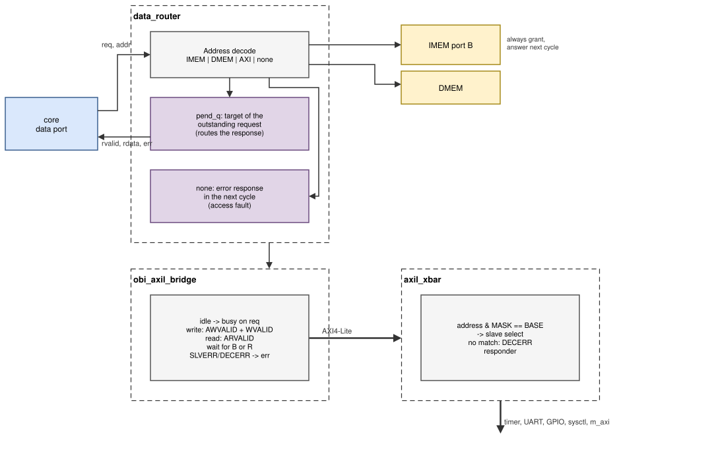
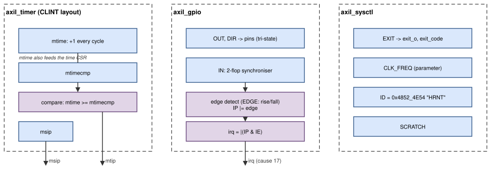
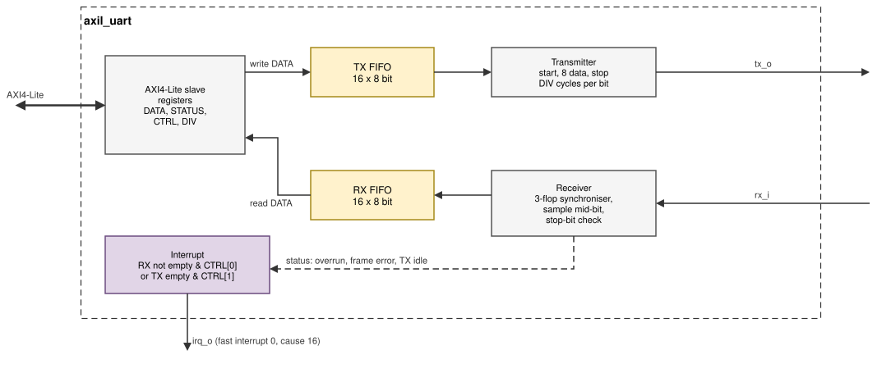

# The SoC inside

This chapter follows an access from the core's ports to the memories and
the peripherals, and explains how the bus blocks and the peripherals work.
The memory map, the interrupt sources, the parameters and the register maps
are in [SoC](soc.md) and [Peripherals](peripherals.md).

## How it operates

1. **Instruction fetch.** The core's instruction port is wired straight to
   port A of the instruction memory (IMEM). IMEM always grants a request and
   answers in the next cycle, so a fetch takes one cycle. An address outside
   IMEM is answered with an error, which becomes an instruction access fault.
2. **Data accesses.** Every load and store leaves the core on the data port.
   `data_router` decodes the address: IMEM (through its second port, B),
   the data memory (DMEM), the AXI4-Lite bus, or nothing. Memory accesses
   take one cycle; bus accesses take a few cycles while the bridge and
   the peripheral finish the AXI4-Lite transaction.
3. **Peripherals.** `obi_axil_bridge` turns the request (OBI [[OBI]](references.md#bus-and-peripheral-standards))
   into one AXI4-Lite [[AXI]](references.md#bus-and-peripheral-standards) read or write; `axil_xbar` sends it to the timer, the UART, the GPIO, the
   system-control block or the external port, and answers `DECERR` itself
   for addresses that belong to none of them.
4. **Errors.** Every failed access (unmapped address, `SLVERR`, `DECERR`)
   comes back as an error bit with the response, and the core turns it into
   a precise load or store access fault.
5. **Interrupts.** The timer drives the machine timer and software
   interrupts and the 64-bit `mtime` value (read through the `time` CSR);
   the UART and GPIO drive fast interrupts 16 and 17; the pins `meip_i` and
   `irq_i[13:0]` bring the external interrupt and fast interrupts 18–31 from
   outside.

*Figure: `data_router` sends each access to IMEM port B, DMEM, the
AXI4-Lite bridge or the error responder; `obi_axil_bridge` turns it into
one AXI4-Lite transaction; `axil_xbar` decodes it for the peripherals.*

## Instruction memory (`imem.v`)

A true dual-port block RAM of `IMEM_SIZE` bytes, initialised from
`IMEM_INIT` (`$readmemh`, one 32-bit word per line).

| Port | User | Behaviour |
|---|---|---|
| A | instruction port | read only; always grants; answers one cycle later; an address outside the memory answers with `err` (instruction access fault) |
| B | data port (through the router) | read and write with byte enables; always grants; answers one cycle later |

Port B lets programs read constants that the linker puts next to the code
(`.rodata`) and lets the bootloader write new programs into IMEM. Both ports
access the same array; Vivado infers one block RAM per 4 KB (RAMB36 in
32 × 1024 mode) [[UG473]](references.md#fpga-and-boards).

## Data memory (`dmem.v`)

A single-port block RAM of `DMEM_SIZE` bytes with byte enables, initialised
from `DMEM_INIT`. It always grants and answers one cycle later. Because the
initial contents of `.data` are part of the image, the startup code does not
copy data at boot; it only clears `.bss`.

## Data router (`data_router.v`)

The router compares the address of each data-port request with the memory
map and forwards the request signals (address, write enable, byte enables,
write data) to exactly one target:

| Address | Target | Grant |
|---|---|---|
| `IMEM_BASE` … `+ IMEM_SIZE` | IMEM port B | immediate |
| `DMEM_BASE` … `+ DMEM_SIZE` | DMEM | immediate |
| `0x2000_0000` … `0x7FFF_FFFF` | AXI4-Lite bridge | when the bridge is idle |
| anything else | none | immediate; error response in the next cycle |

Because the core never has more than one data request outstanding, the
router only has to remember the target of that request (`pend_q`) and use
it to select the response (`rvalid`, `rdata`, `err`). The decode is
combinational and needs no FIFO.

## Request-to-AXI4-Lite bridge (`obi_axil_bridge.v`)

The bridge is a two-state machine:

1. **Idle.** `gnt = 1`. On a request it stores address, data and byte
   enables and raises AWVALID and WVALID (write) or ARVALID (read).
2. **Busy.** `gnt = 0`. Each VALID drops when its READY is seen. BREADY and
   RREADY are always 1. When B (write) or R (read) arrives, the bridge
   answers the core with `rvalid` (and the read data), sets `err` if the
   response is `SLVERR` or `DECERR`, and returns to Idle.

`AxPROT` is 0 (unprivileged, secure, data). The bridge never has more than
one transaction in flight, which matches the core and keeps the
interconnect simple.

## AXI4-Lite interconnect (`axil_xbar.v`)

One master, `N` slaves, each slave described by a `BASE` and a `MASK`: a
slave is selected when `(address & MASK) == BASE`; the first match wins.
Because the master keeps the address stable until the response, the
selection is purely combinational. The AW, W and AR channels are routed to
the selected slave, and its B and R responses back. An address that matches
no slave is answered by the built-in **decode-error responder** with
`DECERR` (the write is accepted and dropped, a read returns 0). The five
slots of `hornet_soc` are listed in
[Peripherals: adding a peripheral](peripherals.md#adding-a-peripheral).

On the plain board top the external port is terminated by
`axil_error_slave`, which answers every access with `DECERR`.

## Peripherals

*Figure: the timer, the GPIO and the system-control block.*

**Timer.** `mtime` is a 64-bit counter that increases by one every clock
cycle. A 64-bit unsigned comparator drives the timer interrupt (MTI) while
`mtime >= mtimecmp`, and `msip` drives the software interrupt (MSI). Writes
use the byte strobes, so each byte can be written on its own. `mtime` is
also wired to the core for the `time` CSR.

*Figure: the UART: a transmitter and a receiver, each with a 16-byte
FIFO.*

**UART transmitter.** When the TX FIFO is not empty and the line is idle,
it takes one byte and shifts out the start bit (0), the 8 data bits (LSB
first) and the stop bit (1), each for `DIV` cycles.

**UART receiver.** The RX line passes through a three-flip-flop
synchroniser. A falling edge starts a frame; the receiver waits half a bit
time to reach the middle of the start bit and checks that it is still 0
(otherwise it was a glitch). It then samples the 8 data bits and the stop
bit, each one bit time apart. A valid stop bit (1) pushes the byte into the
RX FIFO (or sets *overrun* if it is full); an invalid one sets *frame
error* and drops the byte.

**UART FIFOs** (`sync_fifo.v`): 16 entries of 8 bits, with read and write
pointers one bit wider than the address to tell full from empty.

**GPIO.** The inputs pass through a two-flip-flop synchroniser. Each cycle
the synchronised value is compared with the previous one; a rising or
falling edge (as selected by EDGE) sets the pin's bit in IP. The interrupt
is high while `IP & IE` is not zero. All writes respect the byte strobes.

## Design decisions

**Harvard memory without caches.** Version 1 had one 480 KB memory for
code and data behind a hand-written Wishbone crossbar; the instruction and
data ports competed for it and its combinational address path limited the
clock to 26 MHz. Version 2 gives each port its own block RAM. Both are
initialised from the program image in the bitstream, so a fetch and a load
or store never wait for each other and every memory access takes exactly one
cycle. Caches were considered and rejected: the programs fit in block RAM,
caches add uncertainty in timing that students would have to reason about,
and DDR memory is not needed for the target applications.

**The data port reaches IMEM too.** Constants (`.rodata`) stay next to the
code, and a loader can write new programs into IMEM through the second
port of the true dual-port RAM; FENCE.I then makes the core fetch them.

**AXI4-Lite outside the core, not inside.** The core keeps a simple
request/grant/valid port that is easy to verify formally; the SoC converts
it. AXI4-Lite was chosen because students build their FPGA projects in
Vivado block designs, where Xilinx IP (AXI GPIO, AXI UART Lite, AXI Timer,
AXI BRAM controller) speaks AXI4-Lite. One external master port lets them
attach that IP without touching the RTL.

**Router on the core's protocol, AXI only behind the bridge.** Memory
accesses, which are most of the traffic, take one cycle and never touch
AXI. Only peripheral accesses pay the few cycles of the bridge and the
interconnect.

**One transaction at a time.** The core issues one data request at a time,
so an AXI4-Lite master with outstanding transactions or reordering would
add logic without speeding anything up.

**Errors on every path.** Version 1 ignored accesses to unmapped addresses,
and its Wishbone crossbar had no error response at all and registered the
strobe of the wrong port. In version 2, unmapped addresses in the router,
holes in the interconnect (`DECERR`), unknown peripheral registers
(`SLVERR`) and errors from external IP all reach the core as access faults
with the faulting address in `mtval`, so software bugs show up at the
instruction that caused them.

**CLINT layout for the timer.** Standard RISC-V software and Spike use the
CLINT register offsets; using them means existing code works unchanged.
Version 1 had only `mtime`/`mtimecmp`, without the software interrupt.

**FIFOs and interrupts in the UART.** Version 1's UART had no FIFOs, kept
its status bits in odd byte lanes and had a fixed baud rate. With 16-byte
FIFOs and an RX interrupt, a program can receive at full speed while it
computes; the runtime divisor lets one bitstream run at any baud rate.

**A 32-bit GPIO with edge interrupts.** Version 1 had a single write-only
output bit. Version 2 covers the board's LEDs, switches, buttons and a Pmod
connector, with interrupts for buttons.

**A system-control block.** The testbench needs a way for a program to
end the simulation with a result, and programs need the clock frequency to
compute delays and baud rates; both are in one small block that is also
harmless on the board.
