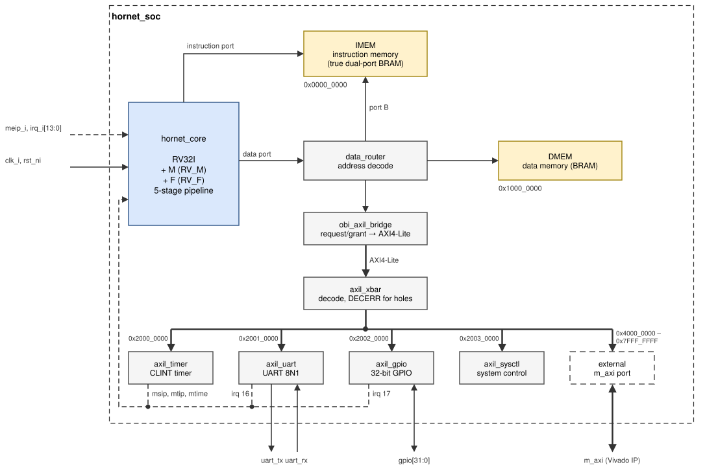
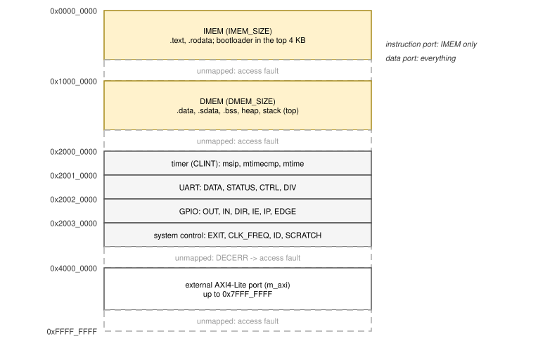

# SoC

`hornet_soc` (`rtl/soc/hornet_soc.v`) is the complete system: the core, two
block-RAM memories, a data-port router, a bridge to AXI4-Lite, an AXI4-Lite
interconnect, four peripherals and one external AXI4-Lite master port. It
has no clock generator or pin logic of its own; the FPGA top
(`fpga/common/hornet_board.v`, [FPGA](fpga.md)) or a Vivado block design
adds those.

*Figure: SoC blocks. Solid lines are data paths, thick lines AXI4-Lite,
dashed lines interrupts.*

## Memory map

| Base | Size | Block | Reached from |
|---|---|---|---|
| `0x0000_0000` | `IMEM_SIZE` (64 KB) | instruction memory: code, constants, bootloader | instruction port (port A), data port (port B) |
| `0x1000_0000` | `DMEM_SIZE` (64 KB) | data memory: data, heap, stack | data port |
| `0x2000_0000` | 64 KB | timer (CLINT layout) | data port, AXI4-Lite |
| `0x2001_0000` | 64 KB | UART | data port, AXI4-Lite |
| `0x2002_0000` | 64 KB | GPIO | data port, AXI4-Lite |
| `0x2003_0000` | 64 KB | system control | data port, AXI4-Lite |
| `0x4000_0000` | 1 GB | external AXI4-Lite master port `m_axi` | data port, AXI4-Lite |

IMEM and DMEM answer every access in the next cycle; a peripheral access
takes a few cycles more through the AXI4-Lite bridge. Everything else
answers with an error, which the core reports as an access fault. Register
maps are in [Peripherals](peripherals.md).

## Interrupt sources

| Source | `mip` bit | `mcause` | Vector (vectored `mtvec`) |
|---|---|---|---|
| timer `msip` (software interrupt) | 3 (MSI) | `0x8000_0003` | `BASE + 0x0C` |
| timer `mtime >= mtimecmp` | 7 (MTI) | `0x8000_0007` | `BASE + 0x1C` |
| pin `meip_i` | 11 (MEI) | `0x8000_000B` | `BASE + 0x2C` |
| UART | 16 | `0x8000_0010` | `BASE + 0x40` |
| GPIO | 17 | `0x8000_0011` | `BASE + 0x44` |
| pins `irq_i[13:0]` | 18–31 | `0x8000_0012`–`0x8000_001F` | `BASE + 0x48`–`0x7C` |

When several are pending and enabled, the highest fast line wins, then MEI,
MSI and MTI. All interrupt inputs are levels: an interrupt stays pending
until the handler removes its cause.

## Parameters

| Parameter | Default | Meaning |
|---|---|---|
| `IMEM_SIZE`, `DMEM_SIZE` | 65536 | memory sizes in bytes (powers of two) |
| `IMEM_INIT`, `DMEM_INIT` | `""` | `$readmemh` image files loaded at configuration |
| `CLK_FREQ` | 50 000 000 | clock frequency in Hz (UART divisor, `SYSCTL CLK_FREQ`) |
| `BAUD` | 115200 | UART baud rate after reset |
| `BOOT_ADDR` | `0x0000_0000` | reset vector and reset value of `mtvec`; `IMEM_SIZE − 0x1000` with the bootloader |
| `RV_M`, `RV_F` | 1, 1 | M and F extensions |

## Ports

| Port | Direction | Meaning |
|---|---|---|
| `clk_i`, `rst_ni` | in | clock; reset, active low, asynchronous assertion, released synchronously by the board top |
| `uart_rx_i`, `uart_tx_o` | in / out | UART, 8N1 |
| `gpio_i[31:0]`, `gpio_o[31:0]`, `gpio_oe_o[31:0]` | in / out | GPIO inputs, outputs and output enables (1 = drive) |
| `meip_i`, `irq_i[13:0]` | in | external interrupt and fast interrupts 2–15 (causes 18–31) |
| `m_axi_*` | AXI4-Lite master | external port, `0x4000_0000`–`0x7FFF_FFFF` |

## Clocking and reset

The SoC has one clock domain. All state that matters after reset (pipeline
valid bits, FSMs, CSRs, peripheral registers) is reset asynchronously by
`rst_ni`; the memories and wide data registers are not reset, as is usual
for block RAM. The board top generates the clock with an MMCM and releases
the reset synchronously, three cycles after the MMCM locks and the reset
button is released.
