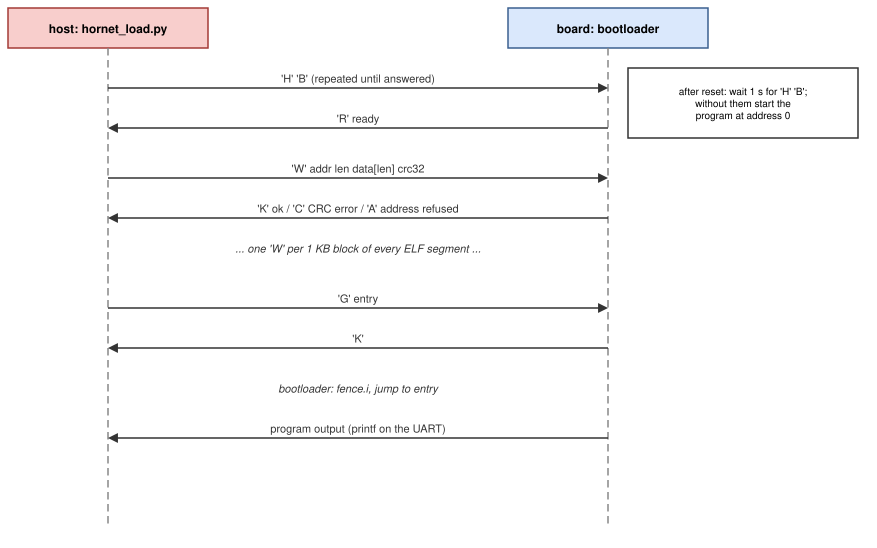

# Software environment

Everything needed to run C on the HORNET SoC is in `sw/`: startup code, a
linker script, newlib [[NEWLIB]](references.md#verification-tools-and-suites) system calls, drivers, build rules, a UART
bootloader, self-checking test programs and examples. Programs are
bare-metal (no operating system), run in machine mode and use the
`ilp32` or `ilp32f` calling convention [[RV-ABI]](references.md#risc-v-specifications).

```text
sw/
├── common.mk        build rules that every program includes
├── common/
│   ├── crt0.S       reset entry: gp, sp, FPU on, trap vector, .bss,
│   │                constructors, main, exit
│   ├── link.ld      IMEM/DMEM layout (sizes from common.mk)
│   └── syscalls.c   printf/scanf on the UART, malloc heap in DMEM, exit,
│                    default trap report
├── drivers/         hornet.h (memory map, CSR macros), uart, gpio, timer, irq
├── bootloader/      UART bootloader (top 4 KB of IMEM)
├── tests/           self-checking SoC tests (make sw-tests)
└── examples/        example programs
```

## Building a program

A program is a directory with C or assembly sources and a Makefile that
includes `common.mk`:

```make
PROG = blink            # optional: output name, default the directory name
SRCS = main.c util.c    # optional: default all *.c and *.S
include ../../common.mk
```

| Target | Result |
|---|---|
| `make` | `build/<prog>.elf`, listing (`.dump`), map, memory images `.imem.hex`, `.dmem.hex`, and `imem.hex`, `dmem.hex`, `mem.cfg` for the FPGA flow |
| `make sim` | runs the program on the SoC testbench (Verilator); `SIM_ARGS="+timeout=<cycles> …"` passes options |
| `make size` | section sizes |
| `make clean` | removes `build/` |

| Variable | Default | Meaning |
|---|---|---|
| `ISA` | `rv32imf` | target configuration; sets `-march=<ISA>_zicsr_zifencei` and `-mabi=ilp32` or `ilp32f` |
| `REQUIRES` | — | `m` and/or `f`: the program needs these extensions in hardware (building for a smaller ISA fails, `make sw-tests` skips it) |
| `IMEM_SIZE`, `DMEM_SIZE` | `0x10000` | memory sizes; the simulation and the bitstream use the same values |
| `STACK_SIZE` | `0x1000` | stack reserved at the top of DMEM |
| `OPT` | `-O2` | optimisation |
| `FLOAT_PRINTF` | 0 | 1 lets `printf` print `%f` (a larger program) |
| `CLK_DIV` | 20 | core clock of the bitstream: 1000 MHz / `CLK_DIV` |
| `USE_DOCKER` | 1 on the host | 0 uses a local `riscv32-unknown-elf-gcc` |

Compiler options: `-mstrict-align` (no misaligned accesses),
`-ffunction-sections -fdata-sections` with `--gc-sections` (unused code is
removed), `-specs=nano.specs` (small newlib), `-lm`. Without F, GCC emits
calls to the soft-float library for `float`; without M, calls for `*`, `/`
and `%`. A program is rebuilt automatically when the ISA, the memory sizes
or the optimisation level change.

`elf2hex.py` writes the memory images: every loadable segment in IMEM goes
into `imem.hex`, every segment in DMEM into `dmem.hex`, one 32-bit word per
line, padded to the memory size.

## Memory layout

| Section | Memory | Contents |
|---|---|---|
| `.text` | IMEM from address 0 | `.init` (`_start`) first, then code |
| `.rodata` | IMEM | constants, `.init_array` (constructors) |
| `.data`, `.sdata` | DMEM from `0x1000_0000` | initialised data; `gp` points 2 KB into `.sdata` |
| `.bss` | DMEM | zero-initialised data (cleared by `crt0`) |
| heap | DMEM, after `.bss` | `malloc` (`_sbrk`), up to the stack |
| stack | top `STACK_SIZE` bytes of DMEM | `sp` starts at the top of DMEM |

The linker stops with an error when data, `.bss` and the stack do not fit.

## Startup (`crt0.S`)

At reset the core starts at address 0 (or the bootloader's address), where
`_start` does:

1. set `gp` (global pointer, for short accesses to small data) and `sp`;
2. in F builds: `mstatus.FS = Initial` and `fcsr = 0`, so FP instructions
   are legal;
3. `mtvec = __trap_entry`, the default trap handler;
4. clear `.bss`;
5. call the constructors in `.init_array`;
6. call `main(0, 0)`, then `exit()` with its return value.

`.data` is not copied: its initial values are already in the DMEM image.

## C library support (`syscalls.c`)

| Function | Behaviour |
|---|---|
| `_write` | `printf`, `puts` … go to UART0; `\n` is sent as `\r\n` |
| `_read` | `scanf`, `getchar` read one byte from UART0 (waiting) |
| `_sbrk` | `malloc` heap between `.bss` and the stack; `ENOMEM` when full |
| `_exit` | waits until the UART has sent everything, writes the exit code to `SYSCTL EXIT` (ends a simulation), then waits forever |
| `hornet_trap` | weak default for unexpected traps: prints `TRAP mcause=… mepc=… mtval=…` and exits with `0x100 \| cause` |

## Drivers (`sw/drivers/`)

| Header | Contents |
|---|---|
| `hornet.h` | base addresses, `REG32()`, `read_csr()`/`write_csr()`, `hornet_cycles()`, `hornet_instret()`, `hornet_clk_freq()`, `hornet_exit()` |
| `uart.h` | `uart_init`, `uart_set_baud`, `uart_transmit_byte/string`, `uart_puts`, `uart_rx_available`, `uart_receive_byte` (waits), `uart_try_receive` (−1 if empty), `uart_wait_tx_idle`, `uart_set_irq`; the global `uart0` |
| `gpio.h` | `gpio_set_dir`, `gpio_write`, `gpio_read`, `gpio_set_pin`, `gpio_clear_pin`, `gpio_toggle_pin`, `gpio_irq_enable(pins, falling)`, `gpio_irq_clear` |
| `timer.h` | `timer_get`, `timer_set_compare`, `timer_set_alarm(cycles)`, `timer_software_irq`, `delay_cycles`, `delay_us`, `delay_ms` |
| `irq.h` | `SET_MTVEC_VECTOR_MODE()`, `SET_MTVEC_DIRECT_MODE()`, `ENABLE/DISABLE_GLOBAL_IRQ()`, `ENABLE/DISABLE_MTI/MSI/MEI()`, `ENABLE/DISABLE_FAST_IRQ(n)`, weak handlers |

The function names of the version 1 drivers are kept, so old programs still
compile.

## Interrupts

`irq.c` contains a vector table. In vectored mode an interrupt with cause
*n* jumps to entry *n*, which calls a weak handler that a program overrides
by defining a function with the same name:

| Interrupt | `mcause` | Handler |
|---|---|---|
| software (`msip`) | 3 | `msi_handler` |
| timer | 7 | `mti_handler` |
| external pin `meip_i` | 11 | `mei_handler` |
| UART | 16 | `fast_irq0_handler` |
| GPIO | 17 | `fast_irq1_handler` |
| pins `irq_i[13:0]` | 18–31 | `fast_irq2_handler` … `fast_irq15_handler` |
| exceptions | 0–11 | `exc_handler` (vectored), `direct_trap_handler` (direct mode) |

```c
#include "gpio.h"
#include "irq.h"
#include "timer.h"

void mti_handler(void)          /* declared with interrupt("machine") in irq.h */
{
    gpio_toggle_pin(0);
    /* next interrupt in 0.5 s; clears this one */
    timer_set_alarm(hornet_clk_freq() / 2);
}

int main(void)
{
    gpio_set_dir(1);
    SET_MTVEC_VECTOR_MODE();
    timer_set_alarm(hornet_clk_freq() / 2);
    ENABLE_MTI();
    ENABLE_GLOBAL_IRQ();
    for (;;) ;
}
```

Handlers are compiled with `__attribute__((interrupt("machine")))`, so
they save the registers they use and return with `mret`. A handler that uses
floating point should also save and restore `fcsr`. An exception handler
must advance `mepc` itself if the instruction is to be skipped.

## Test programs (`sw/tests/`)

`make sw-tests` builds each test for the selected ISA and runs it on the SoC
testbench; each test checks its own results and returns 0.

| Test | Checks |
|---|---|
| `hello` | `printf`, fused multiply-add from C |
| `irq` | ECALL and illegal instruction in direct mode; timer, software, GPIO, fast-pin, external and UART RX interrupts in vectored mode |
| `axi` | external AXI4-Lite RAM (word, half, byte); load/store access faults from `SLVERR`, `DECERR` and an unmapped address; misaligned load; `mcause`, `mtval` |
| `fpu` | bit-exact results, accumulated `fflags`, dynamic rounding with `frm` (needs F) |
| `fencei` | code written into IMEM through the data port runs after FENCE.I |
| `isa` | `misa` of the configuration; M/F instructions trap when the extension is absent; `mstatus.FS` behaviour |

## Examples (`sw/examples/`)

| Directory | What it shows |
|---|---|
| `gpio` | blinks LED0 (the default program of the bitstream) |
| `bubble_sort_float`, `bubble_sort_float_fpga` | FPU loads, stores and compares |
| `fpu_filter` | an IIR filter with FPU arithmetic |
| `uart-fpu-fpga` | receives floats over the UART with interrupts and returns sums, products, quotients and square roots; `fpu_test.py` checks them from the host |
| `IDS-MLP-uart-fpga` | a folded multi-layer perceptron for intrusion detection (NSL-KDD dataset), 300 KB of weights; `make check` compares the simulation with the results measured on the FPGA |
| `axi_gpio` | counts on the LEDs through a Xilinx AXI GPIO on the external port (block-design demo) |

## UART bootloader

The bootloader (`sw/bootloader/`) loads programs over the UART, so a new
program does not need a new bitstream.

**Placement.** It is linked to the top 4 KB of IMEM (`IMEM_SIZE − 0x1000`)
and uses the top 1 KB of DMEM for its stack and variables. The bitstream is
built with `BOOT_ADDR` at its start (`make fpga-build BOOTLOADER=1`), so the
core starts there after reset. Loaded programs must fit below these areas.



*Figure: the protocol between `scripts/hornet_load.py` and the
bootloader.*

**Protocol** (bytes on the UART, words little-endian):

| Command | Bytes | Answer |
|---|---|---|
| hello | `'H' 'B'` | `'R'` (ready) |
| write | `'W'` addr len data[len] crc32 | `'K'` ok, `'C'` CRC error, `'A'` address outside the allowed areas |
| go | `'G'` addr | `'K'`; then FENCE.I and jump to addr |
| ping | `'P'` | `'R'` |

After reset the bootloader waits one second for `'H' 'B'`. If nothing
arrives, it starts the program already in IMEM at address 0 (the one in the
bitstream). The host script sends every loadable ELF segment in 1 KB blocks,
each protected by a CRC-32, and then the entry address. Because the
data port writes IMEM through its second port, FENCE.I before the jump makes
the core fetch the new code.

```bash
# load, then print the output
python3 scripts/hornet_load.py --port /dev/ttyUSB1 prog.elf --term
# the same, stop at a line with "result " and keep a log
python3 scripts/hornet_load.py --port /dev/ttyUSB1 prog.elf --term \
    --until "result " --log out.txt
# the byte stream, for simulation
python3 scripts/hornet_load.py --emit out.bin prog.elf
```

The script keeps sending `'H' 'B'` for `--wait` seconds (default 30), so
the reset button can be pressed at any time, or the board can be
reprogrammed over JTAG meanwhile (`make fpga-run` does this for unattended
runs).
