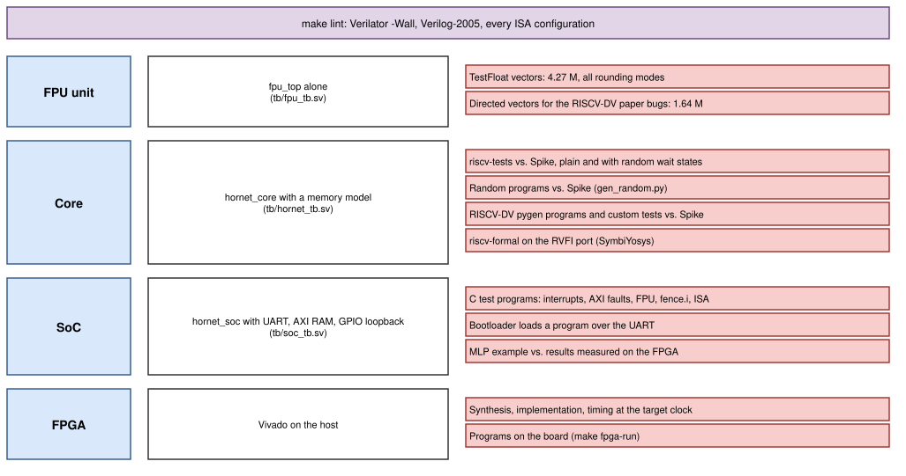
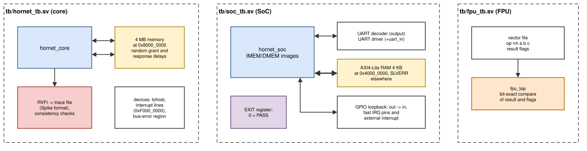
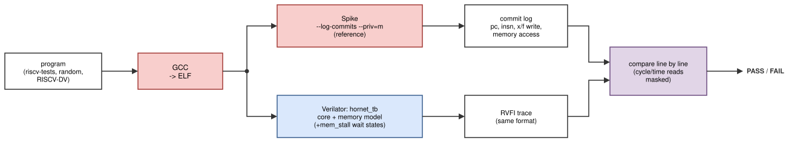
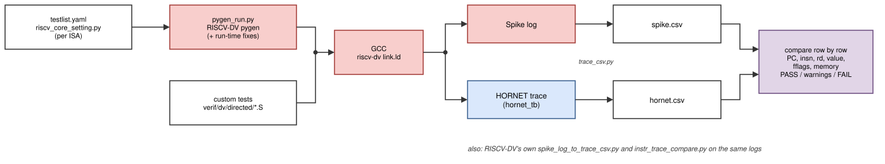
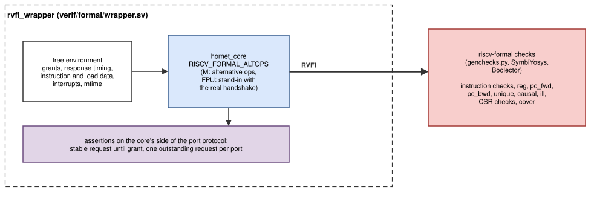

# Verification in depth

This chapter explains each verification method of
[Verification](verification.md): what the testbenches do, how the
reference results are produced, and what each method has found. Every
method compares HORNET with an independent reference, so that a bug cannot
hide behind the same bug in a hand-written expected value.

*Figure: verification levels, the device under test at each level, and
the methods applied to it.*

## Testbenches

*Figure: the three testbenches.*

**Core testbench** (`tb/hornet_tb.sv`). `hornet_core` with a 4 MB memory at
`0x8000_0000` (Spike's default start address) behind both ports.
- `+mem_stall=<pct>` makes the memory withhold grants and delay responses
  (0–3 cycles) at random on both ports.
- A store to `tohost` ends the test (the riscv-tests convention); a write to
  `0xF000_0000` drives the interrupt lines; `0xE000_0000` is a bus-error
  region.
- RVFI is turned into a trace with one line per retired instruction in the
  format of Spike's commit log (`+trace=`): PC, instruction, integer or
  float register write, accumulated `fflags` after FP instructions, memory
  address and store data. The testbench also checks RVFI consistency on the
  fly (order counter, PC chain, `x0` never written).

**SoC testbench** (`tb/soc_tb.sv`). `hornet_soc` with the program images.
It decodes the UART output and prints it; drives the UART input from a file
(optionally in request/answer blocks, for the bootloader); attaches a 4 KB
AXI4-Lite RAM with random ready delays to the external port at
`0x4000_0000` and answers `SLVERR` elsewhere; loops the GPIO outputs back to
the inputs, the fast-interrupt pins and the external interrupt. A write to
`SYSCTL EXIT` ends the simulation: 0 is PASS.

**FPU testbench** (`tb/fpu_tb.sv`). `fpu_top` alone. It reads a vector
file (operation, rounding mode, operands, expected result and flags), drives
`start`, waits for `done`, and compares result and flags bit for bit.

## Lint

`make lint` runs Verilator with `-Wall --language 1364-2005` on
`hornet_core` and on `hornet_soc`, for the selected ISA. Deliberate
exceptions are listed in `rtl/lint.vlt`, each with its reason. Lint is
clean for all three configurations.

## FPU: TestFloat vectors

`scripts/fpu_vectors.py` generates the vectors with `testfloat_gen`
(TestFloat 3e [[TESTFLOAT]](references.md#arithmetic) with the RISC-V specialisation: canonical NaN, tininess
after rounding) for all five rounding modes: `f32_add`, `f32_sub`,
`f32_mul`, `f32_div`, `f32_sqrt`, `f32_to_i32`, `f32_to_ui32`, `i32_to_f32`,
`ui32_to_f32`, `f32_eq`, `f32_lt`, `f32_le` at level 1, and every 40th case of
`f32_mulAdd` (6.1 M cases per rounding mode) for FMADD and, with negated
operands, FMSUB, FNMSUB and FNMADD. Min/max, sign injection and classify
come from a reference model in the script (special values and 20 000
random pairs). Result and flags must match exactly.

| Operation | Vectors | Version 2 | Version 1 (values only) | Version 1 (values and flags) |
|---|---|---|---|---|
| FADD | 232 320 | 0 failures | 102 | 98 571 |
| FSUB | 232 320 | 0 | 103 | 98 608 |
| FMUL | 232 320 | 0 | 128 | 114 191 |
| FMADD, FMSUB, FNMSUB, FNMADD | 4 × 766 660 | 0 | not implemented | not implemented |
| FDIV | 232 320 | 0 | 58 | 176 248 |
| FSQRT | 3 000 | 0 | 0 | 788 |
| FCVT.W.S, FCVT.WU.S | 2 × 3 000 | 0 | 2, 1 | 2 595, 2 780 |
| FCVT.S.W, FCVT.S.WU | 2 × 1 860 | 0 | 0 | 380, 730 |
| FEQ, FLT, FLE | 3 × 46 464 | 0 | 0 | 0 |
| FMIN, FMAX, FSGNJ, FSGNJN, FSGNJX, FCLASS | 6 × 20 400 | 0 | 0 | 0 |
| **total** | **4 270 432** | **0** | | **3 560 239** |

The version 1 columns were measured with the same vectors through an
adapter to its `fpu_arithmetic_top`.

## FPU: directed vectors for the RISCV-DV paper bugs

The RISCV-DV paper on HORNET version 1 (*Creating Verification
Environment Using RISCV-DV With Open and Closed Source Tools*, ISMSIT 2025,
section IV [[ISMSIT25]](references.md#hornet-publications)) lists the FPU bugs that environment found: the dynamic rounding
mode was hardwired; guard, round and sticky bits were wrong in RTZ, RDN and
RUP (its example `0x4BB84A00 − 0x3F800001`, i.e. 24155136 − 1.0000001);
rounding was wrong at overflow, at underflow and in conversions near ±∞;
division and square root of subnormal numbers lost precision.
`scripts/fpu_directed.py` writes vectors for each class in all five
rounding modes. The expected values come from an exact rational model of
binary32 in the script, which first checks itself against TestFloat
(845 340 cases).

| Group | Vectors | Failures |
|---|---|---|
| `paper`: the paper's equation, its mirrored forms, the same pattern at every exponent | 27 610 | 0 |
| `grs`: addend at the guard, round and sticky positions, near cancellation | 199 997 | 0 |
| `tiny`: subnormal and smallest-normal operands and results | 300 000 | 0 |
| `ovf`: results around the largest finite value and the bottom of the subnormal range | 400 000 | 0 |
| `div`: subnormal dividends and divisors | 401 365 | 0 |
| `sqrt`: subnormal inputs (every exponent position, random and boundary mantissas) and normals | 300 460 | 0 |
| `cvt`: FCVT.W[U].S around 0, ±2^31, 2^32, ±∞ and NaN | 8 210 | 0 |
| **total** | **1 637 642** | **0** |

The paper's example in every mode (the faulty FPU returned `0x4BB84A00`
where it must round down):

| `rm` | RNE | RTZ | RDN | RUP | RMM |
|---|---|---|---|---|---|
| result (NX set) | `0x4BB849FF` | `0x4BB849FF` | `0x4BB849FF` | `0x4BB84A00` | `0x4BB849FF` |

`sw/tests/fpu` runs the same subtraction on the SoC with the dynamic
rounding mode (`frm` = 0–4) and with each static `rm` field.

## Co-simulation with Spike

*Figure: every program runs on Spike and on the RTL; the two traces are
compared instruction by instruction.*

`scripts/run_tests.py` builds each program, runs it on the core testbench
and on Spike [[SPIKE]](references.md#verification-tools-and-suites) (`--isa=<ISA>_zicsr_zifencei_zicntr --priv=m --pmpregions=0
--triggers=0 --wfi-as-nop`, the same 4 MB memory), and compares the traces
line by line: PC, instruction word, register write (integer and float),
`fflags`, memory address and store data. Differences that are expected by
design are masked: reads of `cycle`, `time`, `mcycle` and `marchid`.
Trapping instructions, which Spike does not log, are dropped from both.

### riscv-tests

The official riscv-tests [[RV-TESTS]](references.md#verification-tools-and-suites) suites in the `env/p` environment (tests end by
writing `tohost`): `rv32ui` (base integer), `rv32um` (M, with M),
`rv32uf` (F, with F) and `rv32mi` (machine mode: CSRs, traps, interrupts).
Two tests are skipped by design: `rv32ui-ma_data` (misaligned accesses trap
on HORNET) and `rv32mi-pmpaddr` (no PMP).

| Configuration | Tests | Plain | 30 % random wait states |
|---|---|---|---|
| RV32I | 56 (rv32ui, rv32mi) | 56/56 | 56/56 |
| RV32IM | 64 (+ rv32um) | 64/64 | 64/64 |
| RV32IMF | 75 (+ rv32uf) | 75/75 | 75/75 |

CPI with zero wait states (total cycles / total retired instructions of
each suite, including the tests' trap handling): rv32ui 1.19, rv32um 1.47,
rv32uf 1.38, rv32mi 1.43.

### Random programs

`scripts/gen_random.py` writes programs of 400 random instructions after a
prologue that fills all registers with random and special values (NaN,
infinity, subnormals, ±0, the largest and smallest numbers, integer
boundaries). Sources are biased towards the last three destinations, so most
instructions depend on one at distance 1–3: every forwarding path, load-use
stall, late producer and multi-cycle unit is exercised. The mix contains ALU
operations, loads and stores (some misaligned), M instructions with
division corner cases, every F instruction in static and dynamic rounding
modes, CSR traffic on `fflags`, `frm` (also invalid values), `fcsr`,
`mscratch` and `minstret`, branches, JAL, JALR, ECALL, EBREAK, illegal
words, FENCE and FENCE.I. Instructions of an extension the configuration
does not have are still generated at a tenth of their rate: they must trap
on the core exactly as on Spike. A small trap handler skips trapping
instructions and reads `mcause`, so the cause appears in both traces.

| Configuration | Programs | Plain | 30 % random wait states |
|---|---|---|---|
| RV32I | 200 (seed 1) | 200/200 | 200/200 |
| RV32IM | 200 | 200/200 | 200/200 |
| RV32IMF | 200 | 200/200 | 200/200 |

`make random RANDOM=<n> SEED=<s>` runs other sets.

## RISCV-DV

*Figure: the RISCV-DV flow with open-source tools only.*

RISCV-DV (CHIPS Alliance) [[RISCV-DV]](references.md#verification-tools-and-suites) is the instruction generator that version 1's
paper used. `make riscv-dv` (`scripts/riscv_dv.py`) runs the paper's flow
with open-source tools only:

1. **Generate.** RISCV-DV's Python generator (*pygen*) writes a random
   assembly program for each test of `verif/dv/testlist.yaml`, using the
   HORNET core setting `verif/dv/riscv_core_setting.py` (machine mode, the
   instruction groups of the ISA, no PMP, no compressed instructions).
2. **Compile** with GCC and RISCV-DV's linker script.
3. **Run** on Spike (commit log) and on the core testbench (RVFI trace).
4. **Convert** both logs to CSV (`scripts/dv/trace_csv.py`: index, PC,
   instruction, register, value, `fflags`, memory address and data) and
   **compare** them row by row: PASS, PASS with warnings (only masked
   differences) or FAIL.
5. The same logs also go through RISCV-DV's own converter and comparator
   (`spike_log_to_trace_csv.py`, `instr_trace_compare.py`).

Custom tests in `verif/dv/directed/*.S` skip step 1 (the paper notes that
its Python flow could not run hand-written tests): the paper's FPU bugs
(dynamic rounding, GRS, overflow/underflow, subnormal divide and square
root, conversions), M corner cases, ISA-configuration traps and pipeline
hazards. `make riscv-dv-loop` keeps generating programs with new seeds until
one fails, as the paper's main script did to find rare bugs.

The submodule is used unmodified. `scripts/dv/pygen_run.py` registers the
HORNET core setting and fixes pygen bugs at run time (a worker pool that
hangs when a constraint fails, a `KeyError` for EBREAK, load/store streams
whose base register can be `x0` or a reserved register, misaligned accesses
in aligned streams, shallow-copied instruction templates, a missing EBREAK
handler, unsolvable illegal encodings). The loop and HINT streams of pygen
are not used (explained in the test list).

| Configuration | Tests | Programs (generated + custom) | Result |
|---|---|---|---|
| RV32I | 8 generated tests | 17 + 2 | 19/19 |
| RV32IM | the same 8 (pygen adds M instructions) | 17 + 3 | 20/20 |
| RV32IMF | 11 (+ 3 floating-point tests) | 27 + 9 | 36/36 |

## Formal verification (riscv-formal)

*Figure: the formal setup. The environment is free; riscv-formal's
checks observe RVFI.*

riscv-formal (YosysHQ) [[RV-FORMAL]](references.md#verification-tools-and-suites) proves properties of the core with
bounded model checking (SymbiYosys with the Boolector solver [[YOSYS]](references.md#verification-tools-and-suites)). Instead of running
programs, it considers *every* possible instruction stream and memory
timing up to a depth of 12–15 cycles and checks each retired instruction
against a formal model of the ISA.

- `verif/formal/wrapper.sv` leaves grants, response timing, instruction
  and load data, the interrupt lines and `mtime` free (any value in any
  cycle), and asserts the core's side of the port protocol: a request is
  stable until granted, and at most one request per port is outstanding.
- `RISCV_FORMAL_ALTOPS`: the multiplier and divider compute riscv-formal's
  simpler alternative results (a real 32-bit multiplier is too hard for the
  solver), the divider runs 3 steps instead of 32, and the FPU is replaced by
  a stand-in with the same handshake (riscv-formal has no F model).
- Configuration (`verif/formal/checks.cfg`): `isa rv32im` (or `rv32i`),
  `csr_spec 1.12`, `mcountinhibit` as an extra CSR.

| Check group | Checks | What it proves |
|---|---|---|
| `insn_*` | 45 (RV32IM) | each instruction computes the right result, next PC and memory access |
| `reg` | 1 | register reads return the last write |
| `pc_fwd`, `pc_bwd` | 2 | consecutive instructions agree on the PC |
| `unique`, `causal` | 2 | each instruction retires once, in order |
| `ill` | 1 | illegal encodings trap |
| `csrw_*` | 76 | every CSR of `csr_spec 1.12` plus `mcountinhibit` reads and writes correctly |
| `csr_ill_*` | 14 | S/U/H-mode, debug, PMP and `hpmcounter` CSRs are illegal |
| `csrc_const`, `csrc_zero`, `csrc_any` | 9 | ID CSRs are constant, reserved bits read zero, `mscratch` holds any value |
| `cover` | 1 | the environment can retire several instructions |
| **total** | **151** | **151/151** for RV32IMF (2026-10-22, 4 parallel jobs, about 70 minutes; `pc_fwd` alone about 35) |

The counter checks `csrc_inc`/`csrc_upcnt` are filtered: they assume a
core that retires an instruction every cycle and has no `mcountinhibit`.
`minstret` is instead compared exactly with Spike in every co-simulation.

Formal found one bug that simulation had missed: `mepc` had no reset value,
so an `mret` before the first write to `mepc` could jump to a PC with bit 1
set. `mepc[1:0]` now always reads as zero.

## SoC test programs

`make sw-tests` (`scripts/run_sw_tests.py`) builds each program of
`sw/tests/` for the selected ISA and runs it on the SoC testbench
([Software: test programs](software.md#test-programs-swtests)). Programs that
need an extension the configuration lacks are skipped.

| Configuration | Programs | Result |
|---|---|---|
| RV32I | `axi`, `fencei`, `hello`, `irq`, `isa` (`fpu` skipped) | 5/5 |
| RV32IM | the same | 5/5 |
| RV32IMF | + `fpu` | 6/6 |

`make boot-test` puts only the bootloader into IMEM, sends `hello.elf`
through the UART input of the SoC testbench, and checks that the loaded
program runs and passes; it passes for all three configurations.
`make -C sw/examples/IDS-MLP-uart-fpga check` runs the MLP example on six
NSL-KDD samples and compares the classes with those measured on the FPGA
(0 0 4 1 4 4).

## FPGA

`make fpga-build` runs synthesis, implementation and static timing
analysis and prints the worst negative slack; results are in
[FPGA](fpga.md#results). Programs on the board are checked over the UART,
manually with `hornet_load.py --term` or unattended with `make fpga-run`.
